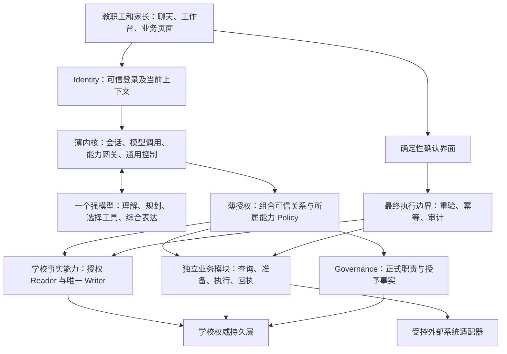

> 公开设计参考副本：历史状态不代表当前交付；已移除私有运行定位。现行边界、三类阶段编号和优先级见 ../README.md。

# K12 单校校园智能平台完整设计稿

## 0. 读法、决定层级与设计结论

本文分清三类内容：

- **已定**：用户已经明确的产品原则，本轮不重新征求同一决定。
- **推荐／待批**：为使整体方案贯通而提出的具体设计，包含适用边界、替代方案及影响，集中见第 18 节。
- **已核实资产**：能由当前源码或明确归因的仓库记录证明的事实，集中见第 14 节。

已定方向是：一个强模型、一个薄内核、一套强学校事实层、一组独立业务能力，以及确定性的身份、授权、事实权威、确认、正式执行、幂等、审计和结果可靠性控制。模型负责理解、推理、规划、追问、工具选择、跨模块综合和自然语言表达；业务模块拥有业务规则、状态和流程。

**按任务最小化提供必要真实事实给模型，是已定原则。** 在可信身份、当前权限和任务用途约束下，让模型取得完成当前任务所需的最小事实；既不默认提供全量资料，也不把“所有真实值一律绕过模型”作为整体备选。工程已确认采用 DeepSeek 服务及获批合成资料；F1具体模型、预算与数据政策已正式批准，见验收台账第9节（历史文档引用），真实学校资料准入仍须 D4 批准。

推荐的完整产品形态是：**以小静为统一自然语言入口，以学校事实产品为独立基础，以模块业务页面为必要操作面，以受控能力接口连接自建模块和学校已有系统。** 模块化是业务所有权和接口边界；常规实现优先模块化单体，并保留必要的安全执行域隔离。

“完整方案”表示本文覆盖目标产品中各类问题的归属、相互依赖及实现路径，不表示所有候选业务都纳入首版，也不表示全文每个语义单元都要建独立表、页面、服务或模块。

### 0.1 与旧文档的关系

现行总体架构（历史文档引用）和编程协议（历史文档引用）明确用户最新决定优先。它们仍包含下列旧约束，实施前必须完成权威文档同步，不能让两套规则并行解释同一产品。

| 旧条款 | 本轮处理 | 依据与影响 |
|---|---|---|
| 面向中学、主要是老师使用 | 未来产品面向 K12 单校，直接用户为教职工和家长 | 已定；不恢复学生登录路径 |
| 一句自然语言恰好一次理解调用 | 允许模型按任务多轮思考和工具调用 | 已定；旧单次调用测试不再能定义目标行为 |
| 一句话最多一个模块 | 允许跨模块查询、准备与综合 | 已定；正式执行仍逐能力授权并明确事务边界 |
| 全部系统敏感值不进模型、用户原话例外 | 按当前任务最小化提供获准的必要真实事实；输入原话不自动豁免具体数据政策 | 任务最小化已定；工程 DeepSeek 服务已确认，F1模型／预算／数据政策已批准（见验收台账第9节），真实资料政策仍待适用批准 |
| 所有模块必须使用 direct/precomposed/compose 三档 | 自然语言主要由模型表达，必要敏感值可直接展示；确定性确认和回执独立 | 不把旧三档恢复为对模型能力的整体限制；具体数据处理归 D4，动作确认细则归 D5 |
| 14 模块及旧阶段先后 | 作为历史候选清单和已完成证据 | 本次范围已批，见第 5.7 节及分阶段计划；F1 已批、F2–F8 未批，后续普通模块由 D1 决定，不否认过去检查点 |
| 学校事实、Governance 分域；每域唯一写核；确定性授权与隔离 | 保留并消费已证明的机制 | 不借新产品设计重开已通过的 SF5A/SF5B 历史结论 |

杭州身份测试部署继续由它自己的进度、事实和计划控制。本文不为其声明用途、范围、验收或状态作任何变更。

## 1. 产品全貌与能力边界

### 1.1 用户最终得到什么

教职工可以通过小静了解学校、准备工作、查询与办理本人有权开展的校园业务。家长可以围绕自己经核实关联的孩子，获取获准的学校信息、联系渠道、通知与业务服务。用户无需知道内部模块名称，但始终能看清正在以什么身份、为谁、办理什么，以及是否真正完成。

产品包含四个使用面：

| 使用面 | 内容与边界 |
|---|---|
| 小静 | 自然语言查询、解释、准备、追问和受控办理；保留当前上下文、相关证据与操作回执 |
| 个人工作台 | 当前身份、关联孩子、模块提供的待办与最近办理记录；它只汇总模块结果，不成为第二套任务权威 |
| 模块业务页面 | 复杂表单、表格、批量预览、审批、附件和历史明细；与聊天共用授权、命令和查询接口 |
| 学校事实管理台 | 来源登记、导入／录入、关系检查、确认发布、纠错、生效历史、覆盖与质量状态；即使没有普通业务模块也成立 |

角色范围是身份关系，不是四套复制的产品。同一人可同时有教职工和家长上下文；学生不直接登录，不通过家长账号冒充学生进行操作。

### 1.2 小静的四种能力承诺

1. **理解并指路**：识别校园需求，说明当前可用能力或学校正式办理渠道；能力未接入时不伪装已能办理。
2. **基于权威回答**：通过受控读取获得事实、版本、时间、来源和覆盖，给出适合当前人的回答。
3. **准备与协作**：生成草稿、比较方案、核对材料、整理候选内容；清楚区分建议与正式学校决定。
4. **受控办理**：准备明确动作，经过正式确认、重新授权和模块执行后，用权威回执报告结果。

一般写作或工作思路可以由模型完成，不得自动包装成学校规定。学校制度、具体学生状态、正式处理结果必须有相应权威依据。

### 1.3 范围分组，不是自动建设清单

- **产品基础建议**：教职工与家长身份、学校事实产品、小静能力循环、薄授权、确认执行、证据与回执、必要管理界面。推荐作为目标产品的共同基础，批准顺序不等于全部同时施工。
- **普通候选业务**：校历与作息、通知、请假、考勤、离校与接送、课后服务、校车、宿舍、报修、检查整改、场地预约、物资与借还、图书服务、教务、考试、作业、成绩查询、报名、学籍服务、证明、内部行政服务等。按真实需要自建、接入、延期或不建。
- **按需高影响业务**：纪律、成绩变更、财务、受限数据导出、权限授撤等。若建设，正式判断由人和相应模块规则控制，不扩展模型权限。
- **明确排除**：学生端；万能工作流、通用 DAG 任务平台、多智能体产品、动态插件市场和逐模块微服务化。

**心理健康、精神障碍及神经发育状况相关永久排除边界（已定，唯一完整定义）**：本平台不建设任何由人工智能开展的、针对人的心理健康、精神障碍或神经发育状况的诊断、筛查、评估、咨询、干预、风险预测、心理或相关状况画像、情绪识别、自伤风险推断，以及自动心理或相关状况预警。

这些排除适用于前台对话、后台分析、文件／量表／行为数据处理和经家长、教职工间接发起的请求；不因改称辅助判断、人工复核、采用本地模型或取得业务模块授权而重新引入。没有学生端不改变这项边界。

**普通人工求助渠道、心理服务信息、生活情绪表达及一般关怀可以正常存在。** 不把日常表达转成上述专业服务或分析。人工服务预约和实际转交由明确业务所有者提供受理／送达结果；显示联系方式或结束聊天不等于完成转交。本文其他章节统一引用本条，不另列缩减版本。

## 2. 学校问题地图与能力归属

下表的自然语言例子是设计候选，不冒充学校已经确认的真实流程或已通过的验收用例。普通业务是否建设以及第一版范围由 D1 决定。

| 编号 | 谁在什么场景下问 | 小静应提供的结果 | 事实／业务所有者 | 正式动作边界 |
|---|---|---|---|---|
| Q01 | 家长：“孩子现在几班，班主任和数学老师是谁？” | 正式关系、时间及获准联系方式 | 学校事实、家校关系授权 | 查询；纠错另走事实维护 |
| Q02 | 教师：“初三3班在哪里？我在哪个办公室？” | 班级固定教室、办公地点及校区 | 学校事实 | 固定地点不代表实时人在何处 |
| Q03 | 家长／教师：“明天几点上课、几点放学？” | 对应学段、校区、班级的有效安排 | 事实时间口径；校历／作息 | 未发布安排不可推算为学校正式安排 |
| Q04 | 教师：“今天谁代课？下一节到哪里？” | 正式任课与课次临时安排的明确区别 | 学校事实；课表／代课模块 | 调课、代课确认归教务 |
| Q05 | 家长：“我两个孩子为什么只显示一个？” | 关联状态和核验渠道，不暴露其他学生 | Identity、学校事实、家校服务 | 关联申请不自动产生访问权 |
| Q06 | 家长：“有什么通知要处理？这份通知改过吗？” | 适用通知、版本和本人回执 | 通知模块；事实受众关系 | 发布、撤回、确认均有明确对象 |
| Q07 | 班主任：“哪些家长还没确认家长会？” | 在有权且完整的受众集合内统计 | 通知／活动模块 | 未送达、未读、未确认分别表达 |
| Q08 | 家长：“替孩子请假，是否批准了？” | 申请准备、批准状态与有效范围 | 请假模块 | 提交不等于批准，不代替人工审批 |
| Q09 | 教师：“请假已批，为何仍记缺勤？” | 分别解释请假、考勤和待核对项 | 请假、考勤各自权威 | 不从一个状态自动改写另一个 |
| Q10 | 家长：“今天外婆代接，取消托管后几点接？” | 代接／课后服务申请及交接要求 | 经核实家校关系；接送、课后服务 | 联系人、获准代接、实际交接分开 |
| Q11 | 家长：“校车路线变了吗？今天还坐哪班车？” | 已发布班次、乘车关系及异常安排 | 校车服务 | 不推断学生实时位置 |
| Q12 | 家长／宿管：“住哪栋楼哪张床？调宿生效了吗？” | 正式住宿和调宿办理状态 | 学校事实；宿舍模块 | 空床不自动等于可分配，批准不等于入住 |
| Q13 | 教师：“空调坏了，修到哪一步？” | 报修准备、工单真实进度 | 报修模块；地点事实 | AI 不认定责任、派单或确认维修完成 |
| Q14 | 检查人员：“这些卫生问题谁整改、谁复核？” | 已发布规则及具体检查记录 | 检查整改模块；治理授权 | 人工检查、整改、复核各有权限 |
| Q15 | 教师：“找一个会议室，预约后通知参会人。” | 可用性、预约与通知分别回执 | 预约模块、通知模块 | 说明部分成功，不暗示跨模块原子完成 |
| Q16 | 教师：“借投影仪，申领这批物资。” | 可借／库存状态、申请与领取结果 | 资产借还、物资模块 | 地点和设备身份不能代替库存规则 |
| Q17 | 家长：“孩子未交哪些作业？成绩公布了吗？” | 获准的正式记录与发布状态 | 作业、考试／成绩模块 | 不自动评级、定性或修改正式成绩 |
| Q18 | 家长：“报名成功就是录取了吗？” | 申请、核验、候补与录取状态 | 活动／社团／招生等所属模块 | 资格、名额、冲突和录取归业务 |
| Q19 | 家长：“转班何时生效？毕业后怎么办证明？” | 在校／归班事实及服务进度 | 学校事实；学籍／证明服务 | 审批、事实生效、证明签发区分 |
| Q20 | 教师：“我兼哪些课、属于哪个教研组？” | 正式任职、成员及任教关系 | 学校事实 | 事实关系不自动授予学生详情权限 |
| Q21 | 用户：“教务处办什么？制度是否适用于小学部？” | 正式部门职能、服务入口、有效制度 | 学校事实、制度检索能力 | 模型解释不创造新规定 |
| Q22 | 用户：“图书如何续借？心理服务找谁？” | 正式服务信息；接入后查询或申请 | 服务目录；图书／人工服务模块 | 遵守永久排除边界（历史文档引用）；未接入时仅指路 |
| Q23 | 校方：“两处学生人数为何不同？” | 时间、对象集合、状态口径、覆盖差异 | 学校事实或相应模块统计 Reader | 无权限和覆盖不完整不能当作零 |
| Q24 | 用户：“班主任信息错了，谁能更正？” | 纠错受理、责任人和正式变更结果 | 学校事实管理产品 | 用户陈述作为待核实线索，不直接覆盖权威 |
| Q25 | 人事／教务：“下学年升级、分班、教师调岗怎么办？” | 未来关系变更预览、依赖检查和生效结果 | 学校事实；人事／学籍业务（如启用） | 不用改名称批量覆盖历史；权限同时重验 |
| Q26 | 管理者：“哪些事项还没落实？” | 各模块有权查询的待办／进度汇总 | 各模块拥有状态；工作台只聚合 | 不建设全平台第二套任务状态机 |

同一问题可有多种合法答案；具体差异取决于学校事实和模块已发布规则，不靠内核维护业务问答模板。

## 3. 系统结构与所有权

图中共享持久基础设施不意味着共享私有表。模型不直接连接授权服务、数据库或 Secret；它提出工具调用候选，由网关解析当前身份、授权并调用公开能力。确认凭据通过可信界面交给执行边界，不作为模型可自由生成的工具参数。

| 组成 | 拥有 | 不拥有 |
|---|---|---|
| Identity | 认证协议、会话、凭据、消费正式账号—人员映射并解析可信上下文、上下文选择与失效 | E05 正式映射写权、学校姓名权威、家校关系事实、业务权限结论 |
| School Facts | 学校实体、共享现实关系、正式有效期、事实规范、来源／覆盖及唯一发布 | 模块流程、工单状态、具体 action 权限 |
| Governance | 正式职责词典、任职绑定的职责授予、范围、依据引用及撤销 | 家长虚构任职、模块动作词典、审批过程状态 |
| Module Policy／事实能力 Policy | 所属动作、资源规则、用途与允许条件 | 第二份人员／家校／Governance 事实 |
| Thin Authorization | 可信上下文、Policy 计算、ScopePlan、字段 Projection、撤权重验 | 通用 SQL 查询器、模块业务状态、自然语言权限判断 |
| 业务模块 | 本域规则、状态、流程、数据、查询和正式命令、业务恢复 | 他域私有表，其他领域的第二权威 |
| 小静薄内核 | 模型循环、当前能力目录、会话隔离、取消／超时、确认转交、通用操作索引 | 学校业务含义、跨模块流程状态机、调课或报修算法 |
| 集成适配器 | 厂商协议、凭据使用、超时和受控传输 | 私自决定学校事实、权限和正式业务成功 |

学校事实的校验与写入逻辑可以很严密，它是事实领域的规则，不属于小静通用内核。完整平台不要求每个部分都“薄”；只要求复杂度留在它的正确所有者。

## 4. 学校事实的共同规范

### 4.1 “完整目录”的口径

第 5 节完整列出当前 19 类规范事实、推荐增量及明确归其他域的数据。目录按语义闭合，不预先规定物理表数。任意将来的新业务都有自己的事实；不能以“完整”为由把所有未来业务数据塞进 School Facts。

纳入学校事实的推荐判据是：它表达学校正式实体或共享现实关系；没有相应普通业务模块时仍应能独立维护或回答；跨模块引用应使用同一身份和解释；其变化不需要把具体业务状态机搬进事实层。更新频率不是划界标准。

### 4.2 每类事实必须给出的规范

| 规范项 | 推荐约束 |
|---|---|
| 身份 | 稳定内部身份及稳定来源身份；名字、显示路径、电话、班号不能作为自动合并依据 |
| 含义及所有者 | 定义这条事实究竟说明什么、由谁发布和纠正；每个语义字段或关系只有一个正式权威 |
| 引用 | 使用类型明确的学校、人员、组织、地点等引用；不能用模型拼出的显示文字连接对象 |
| 有效时间 | 区分现实生效／结束时间与系统记录时间；当前、历史、未来都能明确表达 |
| 版本与纠正 | 复用已有正式版本／血缘基础，保留纠错前后及原因；不能静默改写历史 |
| 多值规则 | 按关系定义合法并行、主次、适用范围、唯一条件；多条记录不自动冲突 |
| 真实性 | 权威来源、依据引用、确认责任、覆盖与更新状态；导入成功不等于学校确认事实真实 |
| 访问与模型 | 人可看什么、模型可收什么分别由 Policy 决定；历史权限不从当前关系简单倒推 |
| 生命周期 | 新建、修正、正常结束、撤销、重新成立分清；不把 School Facts 与 Governance 的 revoke 语义混同 |
| 读写入口 | 窄 Reader、正式 Writer、预检／确认／回执及相应失败；导入、表单、模块不能各开写旁路 |

历史读取至少区别“现在依据纠正后的记录认为过去怎样”和“当时系统曾记录怎样”。已有血缘能覆盖哪些历史由实现核证；不能在缺少记录时承诺重建完整过去。

### 4.3 结果不是一个互斥状态枚举

| 维度 | 必须表达的情况 |
|---|---|
| 对象解析 | 唯一、多个候选、未找到可确认对象；候选本身必须先授权 |
| 访问 | 允许、部分字段可见、拒绝；对外是否透露对象存在由资源 Policy 决定 |
| 证据 | 权威已知、未录入／未知、官方明确否定、冲突 |
| 时间 | 当前、历史、未来已发布、未来未发布；查询时点明确 |
| 时效与来源 | 校验有效、过期、来源暂不可用、仅缓存／历史副本 |
| 覆盖 | 完整覆盖指定集合、部分覆盖、未知覆盖；统计注明母集和时间 |

这些维度可组合。允许回答“已正式发布的下周班主任”，也允许回答“有主校区结果，但分校区未完成录入”。内部严格区分拒绝与未知，不要求对所有用户暴露内部拒绝原因。

**未录入不等于不存在。** “没有班主任”“学校不提供校车”等否定结论，必须有对应事实类型支持的正式空缺／不提供声明，或经批准的完整权威集合发布能够证明精确范围内为空；普通搜索零行、被权限裁剪后的空集、分页未读完均不能证明不存在。

冲突按事实类型判断。例如同一教学班可以共同任教；同一老师可以在不同地点办公；当前住宿在排他有效区间内不允许同一学生同时占两张正式床位。最后一条依赖既有住宿规范，不能推广为所有关系均单值。

冲突受理也须有类型规则和依据等级。低可信线索与当前权威不同，不自动撤销或遮蔽已发布事实；应说明当前正式结论及适当的待核实状态。确有同等权威竞争或正式争议状态时，按类型范围标为冲突并交维护责任人处理，模型不能选一个自认更合理的值。

## 5. 完整学校事实目录与规范增量矩阵

### 5.1 当前 19 类：全部保留，逐项确定目标位置

“已有”仅指 Canonical 及写入基础存在，不表示完整产品读取、家长授权或端到端办理已交付。

| 编号 | 当前 Canonical 类别 | 目标语义与建议增量 | 不应混入 |
|---|---|---|---|
| E01 | `school` 学校 | 唯一学校主体、名称及正式状态；关联开设学段与学年 | 多租户市场、由用户选择数据库 |
| E02 | `person` 人员 | 学校自然人及姓名历史；补充同一人可兼教职工与家长的分类表达，具体关系决定身份 | 登录昵称权威、单一 person_kind 决定全部权限 |
| E03 | `student` 学生 | 学生稳定主体，关联自然人；保留入校前后身份连续性规则 | 学生登录权、成绩及永久排除边界（历史文档引用）内能力 |
| E04 | `student_school_relationship` 在校关系 | 在校状态、学号、主要就读校区、行政管理校区及走读／寄宿正式属性；与归班、班级主要校区和组织校区关系分别保留 | 申请进度、考勤、实时位置 |
| E05 | `login_mapping` 登录映射 | 保留经核实账号与人员的关联，补足家长身份映射流程适用性；认证协议仍归 Identity | 学校姓名来源、家校关系和业务授予 |
| E06 | `organization` 组织 | 稳定组织身份及层级；扩展正式部门、年级组、教研组、备课组、班级等受控类型 | 仅按名称判类别、把层级当自动授权 |
| E07 | `organization_campus_relationship` 组织与校区 | 组织覆盖／所在校区的明确现实关系；保留多校区与时间 | 全校业务权限、默认后代授权 |
| E08 | `assignment` 任职 | 人员在组织的正式／兼任／代任及有效期；与班主任、任教关系引用衔接 | 把岗位名称当 action 权限、工单负责人 |
| E09 | `location` 地点 | 校区、楼栋、楼层、房间、区域的唯一身份与历史 | 设备库存、预约占用和实时人员定位 |
| E10 | `location_alias` 地点别名 | 标准对象的地方叫法、有效期及必要语境 | 跨校区同名自动合并 |
| E11 | `dorm_room` 宿舍房间 | 地点的正式住宿用途与容量属性，关联宿舍楼语义 | 调宿审批、当晚点名 |
| E12 | `dorm_bed` 床位 | 可识别的正式床位资源及状态 | 无条件可分配承诺 |
| E13 | `student_bed_residence` 学生住宿 | 学生与床位的正式有效关系、历史与未来；保留唯一写核 | 宿舍模块第二份可写住宿真相 |
| E14 | `person_contact` 个人联系方式 | 联系方式及原有可见性，增加家长访问时以新 Policy 单独判断 | 默认向家长开放校内通讯录 |
| E15 | `student_contact` 学生联系人 | 联系人与学生的联系用途、登记称谓及其来源、优先级、紧急联系属性；登记称谓不代替 N26 核实结论 | 经核实家校关系、代办或接送权限 |
| E16 | `official_contact` 官方联系方式 | 学校／部门／地点的正式服务渠道与服务信息 | 将私人号码冒充官方服务号码 |
| E17 | `policy` 制度 | 制度稳定目录及发布主体 | 模型生成规定、检索索引权威 |
| E18 | `policy_scope` 制度适用范围 | 保留组织／校区范围，按学段、班级等需求扩展明确适用语义 | 用缺记录表示全校适用；与授权 Scope 混同 |
| E19 | `policy_version` 制度版本 | 正文、分级、有效期、替代与撤销及引用 | 未核实文档自动覆盖正式制度 |

源码清单依据：school_facts/contracts.py（历史文档引用） L14–34。旧行政班、StudentEnrollment、GuardianRelationship 表属于 legacy_disabled，不计入以上目录，也不直接恢复为权威。

### 5.2 新增规范语义目录

以下 N01–N29 的本次语义范围已批准，限定见第 5.7 节。英文是建议规范名，不代表已经创建的类型或独立表。`档案`优先复用已有主体身份；`关系`应有独立有效期和来源。按事实族形成实际维护与查询消费者时实现所需结构，不预建无消费者的空表。

| 编号／建议规范名 | 类型与最小规范内容 | 关系、多值与时间规则 | 回答的关键问题 |
|---|---|---|---|
| N01 `education_stage` | 学段词典：稳定码、正式名称、适用定义 | 可表达小学／初中／高中，避免强制每校齐备三段 | 学校有哪些学段 |
| N02 `school_stage_offering` | 学校开设学段及适用校区关系 | 学段可跨校区；明确生效和停止，未录入不等于未开设 | 这个校区有小学部吗 |
| N03 `academic_year` | 学年：身份、名称、起止及发布状态 | 校级共同口径；不硬编码自然年与学年相同 | 本学年和下一学年指什么 |
| N04 `academic_term` | 学期：所属学年、名称、起止、适用范围 | 学期边界与上课日不同；差异范围必须明确 | 当前学期、未来任课从何时起 |
| N05 `grade_definition` | 年级定义：学段、正式名、顺序及地方别称 | 不将“初一”与永久某届学生绑定 | 初一对应什么年级 |
| N06 `student_cohort` | 届别／入学批次：学校、学段、正式口径、年份标签 | 是分组事实，留级／转入不会自动改变所有归属；不靠年龄推算 | 2026级和初一年级有什么区别 |
| N07 `year_grade_group` | 某学年的年级群体：学年、年级定义、关联正式组织 | 同一群体可覆盖多校区；与届别并非一一对应 | 本学年初一年级有哪些班 |
| N08 `administrative_class_profile` | 行政班档案：复用组织身份、正式班号／名称、生命周期 | 推荐真实班集体连续时保留身份；重新组班、拆并要显式变化 | “三班”究竟是哪一个班 |
| N09 `class_placement` | 行政班与学年年级、主要校区的有效关系 | 主要行政归属与临时上课校区不同；转移保留历史 | 班级今年在哪个年级校区 |
| N10 `student_class_membership` | 学生—行政班关系：类型、开始／结束、正式依据 | 推荐同一普通在校关系同时一个主要行政班；特殊并行需有学校明确类型 | 孩子当前／当时在哪个班 |
| N11 `class_headship` | 任职—行政班关系：正／副／共同班主任等正式类型 | 不预设所有学校只能一人；各类型明确并行规则与期限 | 班主任、副班主任是谁 |
| N12 `subject` | 学科：稳定码、正式名、适用学段和别名 | 同名跨学段是否同一学科由词典确定，不按名称拼接 | 数学、科学等正式学科是什么 |
| N13 `course` | 课程目录：稳定身份、名称、课程性质、正式状态 | 课程不是某一天课次；可有跨学科课程 | 学校开设哪些课程 |
| N14 `course_subject_relationship` | 课程—学科关系及必要角色说明 | 允许一课多学科；不得为方便只取第一学科 | 这门综合课程涉及哪些学科 |
| N15 `teaching_group_profile` | 实际独立教学班的档案：复用正式组织身份、名称、类型和有效期 | 用于走班等独立教学组织；普通整班教学不因此必须创建一套影子教学班 | 孩子参加哪个独立教学班 |
| N16 `course_offering` | 持续正式开课：课程、类型明确的授课对象、教学成员来源及独立有效期间 | 授课对象可为行政班或独立教学群体；成员采用已发布A／B来源。学期用于定位／展示，不强制每学期复制或结束；不含逐节课次 | 这门课面向哪个群体，按当前安排以后是否延续 |
| N17 `teaching_membership` | 正式教学成员来源；必要时保存独立成员关系及有效期 | A 明确引用行政班正式成员；B 独立发布教学成员；同一开课及时段只有一种正式来源解释，不无条件求并集 | 孩子是否属于这门课的正式授课对象 |
| N18 `teaching_assignment` | 教职工任职—正式开课关系、主讲／共同任教等角色及有效期间 | 可无预定结束，换学期／正常升年默认沿用；明确截止和正式交接优先，不续权限、不继承到新班／新课／新群体；不替代课次代课 | 谁正式教孩子这门课，未来按现有安排由谁教 |
| N19 `education_organization_profile` | 正式部门／年级组／教研组／备课组档案、职能说明及依据 | 复用组织身份；制度性职能用于解释，不直接变成业务权限 | 教务处和教研组分别做什么 |
| N20 `organization_membership` | 人员—组织成员关系及成员类型 | 正式任职继续归 E08；只有非任职型成员关系才用此类，避免重复同一事实 | 哪些老师属于某教研组 |
| N21 `school_service_directory` | 正式服务目录：服务名、负责组织、适用对象、官方渠道／制度引用 | 推荐按需启用；联系方式引用 E16，不抄第二份值；开放例外归校历／服务模块 | 这项业务找谁、在哪里办 |
| N22 `organization_workplace` | 组织—地点关系：办公／接待等用途及有效期 | 可多处办公；“主要”仅在学校明确时设置 | 某部门办公室在哪里 |
| N23 `person_assignment_workplace` | 人员或任职—地点关系，二者恰选一种明确主体 | 人员一般办公与某任职办公分清；支持多地点并行，不自动推导在场 | 王老师在哪办公 |
| N24 `class_base_location` | 行政班—地点关系：固定教室／活动室等用途 | 可多个不同用途；固定教室不等于现在正在上课的房间 | 初三3班固定教室在哪里 |
| N25 `dormitory_building_profile` | 地点的宿舍楼／住宿区域用途档案，及房间所属关系 | 复用地点身份；支持混合用途楼，不要求整楼只能住宿；不得重复维护物理父子关系 | 宿舍楼与普通教学楼有何区别 |
| N26 `verified_family_school_relationship` | 成人—学生经核实的家校关系：关系类型、核验主体、依据引用、有效期、限制状态 | 联系用途、亲属／监护陈述与校方核实分开；多成人、多孩子合法；本关系不是任何 action 的全权许可 | 当前家长可关联哪个孩子 |
| N27 `student_cohort_membership` | 学生—届别／批次关系、种类、依据与有效时间 | 入学届别、预计毕业分组、实际毕业分开；转入留级按正式变化处理，不按当前年级倒推 | 这名学生属于哪届，毕业人数按什么口径 |
| N28 `education_organization_scope_relationship` | 教研／备课／年级组织与学科、学段、学年年级、学期的类型化现实关系 | 可多个明确目标；不是 Governance 授权 Scope，不自动包含后代 | 初三数学备课组有哪些老师，覆盖哪个学期 |
| N29 `person_address` | 人员居住／通信地点信息：用途、允许粒度、地区或地址、来源与有效时间 | 按真实用途可只记录地区，不要求精确地址；不进入公共校园地点目录，不作为认证依据 | 家住哪个片区；获准服务是否需要联系地址 |

**2026-09-13用户确认补充：固定班名、口语称呼与班内学生职务。当前F4完整工作包已获批准，实际实现／验收以项目进度第10节及F4交付说明为准。**

- 当时用户仅授权完成F4完整设计（历史文档引用）交审，设计批准后再实施。本补充与F4稿接续原设计，不重开F2／框架迁移，也不因F3基本体验认可抹除其已知速度和表达限制。
- 正式班名与当前年级分开。班名可以从入学到毕业保持不变；学校一次正式配置学年切换日期和递进规则后，正常升年到期自动进行，无年度申请、逐班确认、逐学生操作或人工发布新学年前置。不自动改班名、班主任、固定教室或班干部，也不从班名数字推算入学年份、届别、年级或班序。毕业和跨学段入学不能仅凭递进自动认定。
- 个别转班、留级、休复学及高中行政重新分班按学校已经确定的事实分别处理；正常升年延续原班集体，新组班不自动继承原班老师、教室和干部。纯选科走班仍归F5。家长沿获准孩子→当前／获准历史班级→班主任查询，不默认取得全班名单、他人职务或私人联系方式。
- “初二三班／初二3班”由大模型理解，受控事实工具根据当时有效的年级、正式班序或获确认称呼定位班级，例如正式班名“2023班”。后端不另建语言理解器、关键词问答或逐句别名模板；没有学校对应依据时不能猜，真实多候选才按获权条件消歧。升年后的称呼与历史时期分别取当时正式关系。
- 新增班内学生职务事实：学生、班级、岗位、开始时间及正式来源；结束时间可空。班长、副班长等无预设任期，正常升年或学期更替继续生效，不要求定期重录；正式更换按确认的生效时间结束被替换的任职，登记新任职并保留历史，不影响其他岗位。
- 用户明确批准的结束例外：学生正式转班、毕业或班级撤销时，在相应正式变更中一并结束对应的现任班干部记录，按该变更生效时间处理，保留原历史；未确认的意向和预计毕业不触发结束。
- 班内学生职务只用于事实维护和获权查询，不生成学生登录入口、系统权限、任务、审批或治理能力，不接入教职工任职授权链。该新增语义由F4交付，不预定新增表、页面或服务数量。

本次已批准的 N01–N29 语义按事实族分阶段实现，居住信息仅限获准最小地区；全部批准范围进入 P3F 整体验收。届别、入学批次及学生关系正式区分“级”“届”和当前年级，学校口径不明时不能猜测。普通整班教学引用有效行政班成员；确有独立名单的教学使用独立成员来源，Reader 解释正式来源，不按名称或模型推测。

E15 的登记称谓和来源继续保留；N26 发布经核实的对应关系结论。不一致时进入 M04 待核实，不能并存为两份同等权威的亲属真相，也不静默丢弃旧记录。

N26 只保存现实关系及核实状态；“可以请假”“可以代接”由家校业务授权／模块 Policy 管理，不能把所有可办事项固化进关系类型。依据原件如需保留，由受限证据持有者保存，事实层只引用，不把原件送入模型。

### 5.2.1 教学成员来源的两种方案（组合使用已定，代价比较保留）

| 比较项 | A：普通整班教学引用正式行政班成员来源 | B：所有教学独立建立教学成员关系 |
|---|---|---|
| 录入与存储 | 发布开课时登记来源行政班、适用开课和有效期；复用正式班级成员，不重复录入名单 | 可批量生成，但每个需要独立名册的教学范围仍须正式发布成员；整班也增加一份集合 |
| 转班与一致性 | 跟随模式按查询事实时点解析正式归班，转班生效后不需逐课同步 | 名单若实际独立，转班不应自动改；若学校要求随班，需可靠传播／发布，处理漏项、错时和中断 |
| 历史与未来 | 查询当时有效的来源及行政班成员，保留来源定义版本和解析依据；不能拿当前名册冒充历史 | 查询独立成员有效期及发布版本；未来行政分班完成不代表未来教学名册已发布 |
| 走班与个别差异 | 适合真正整班共同授课；正式成员有差异时选择独立来源，或另批有限例外，不能暗加任意过滤表达式 | 适合选修、分层、跨班组合及独立退课，差异直接表达；普通请假／单次免到仍不等于退出正式成员 |
| 查询及验收成本 | Reader 多解释一层明确来源；验证时间、来源切换、权限和缓存失效；可建不可独立改写的投影 | 读取形态更统一，但需验证展开完整性、重复导入、同步与失败恢复；多份机械副本不会自动增加权威性 |

**已定：普通整班教学使用 A，引用有效行政班成员；确有独立名单的教学使用 B。** 上表保留与“所有教学一律独立维护成员”的代价对照，本次不采用普通整班影子名单。同一开课、成员范围和有效区间只能有一个正式来源解释，切换来源要有明确生效点。

A 推荐跟随“查询事实时点的有效行政班成员”。来源关系明确类型、行政班稳定身份、适用开课、有效期和发布依据；来源定义版本与本次解析的成员依据版本分开，不能把开课创建时的名单版本永久锁住后仍称为跟随。查询过去使用历史事实，查询未来依据已发布未来关系及覆盖；权限仍按当前请求重验。需要真正冻结名单时，显式选择固定独立成员或另批快照语义。考试、点名或通知保存本次采用的名单，是业务历史凭据，不因此产生第二套当前教学成员权威。

若 B 的成员完全由行政班机械派生且不允许独立修改，应把它视作 A 的可重建读取投影，而非再建一个可写权威。两种方式通过统一 Reader 返回成员结果、来源方式、事实时点、依据版本和覆盖；家长查看自己孩子的关系不因此获得全班名册。来源决定由有权事实维护者或教务业务通过正式发布作出，事实 Writer 不承担成员选择、转班传播或课程豁免规则。

### 5.3 事实权威与质量的规范增量

这些是事实产品的管理语义，不计成与人员、班级并列的新学校实体，更不是通用规则引擎。

| 编号 | 建议增量 | 规范与失败行为 |
|---|---|---|
| M01 | 权威来源登记与字段／关系所有权 | 明确哪一来源对哪一类、范围、时期有发布权；第三方连接成功不自动取得权威；不按“最后到达”选赢家 |
| M02 | 覆盖声明 | 某来源覆盖的校区、学段、对象集合、时期、完整程度及更新时间；覆盖声明本身有正式维护责任 |
| M03 | 类型限定的否定／空缺声明 | 对精确主体、关系种类、范围、时期声明“不提供／空缺／无此项”；必须由该类型认可的权威发布，不能创建任意文字断言万能表 |
| M04 | 冲突与待核实记录 | 保留候选证据、争议范围、责任人和处置状态；争议不是两个正式 Writer 各自发布权威版本的许可 |
| M05 | 时效与更新责任 | 区分事实有效期、来源最后成功同步、最后核实时间、类型时效规则；同步失败不自动撤销原事实 |
| M06 | 显式身份匹配与纠正 | 名称相似只生成候选；合并、拆分、错关联处理有预览、引用影响和正式确认，不做静默自动合并 |

### 5.4 规范增量到施工面的矩阵

所有新增类别都须继承第 4.2 节共同规范。表中导入／表单项是建议的新语义输入，不在本轮创建 Excel 页或列；实际文件格式可批量表达，不能要求学校手填数据库外键。

| 增量组 | 涉及目录 | Canonical／Writer | Reader／授权 | 输入与界面变化 | 主要依赖／验收 |
|---|---|---|---|---|---|
| I01 教育结构与时间 | N01–N07/N27；E01/E06/E07 | 类型化学段、学年、学期、年级及关系；引用和时间约束 | 学校／校区范围的公开或校内结构查询；未来与历史 | 学段、学期起止、年级／届别来源输入；年份和范围预览 | 明确学制口径；跨校区差异、未来未发布、升年历史 |
| I02 行政班与归班 | N08–N11；E03/E04/E08 | 正式班身份、归属、成员、班主任关系；合法多值规则 | 教职工按关系／职责，家长按关联学生取最小字段 | 班级名册、归班、正副班主任及生效时间；稳定引用自动匹配候选供确认 | I01、可信身份；同名班、转班、共同班主任、历史 |
| I03 正式教学关系 | N12–N18 | 学科、课程、授课对象、正式成员来源及任教链；独立成员仅在所选方案需要时发布 | 统一窄 Reader 解析 A／B 来源；按学生／教学范围限行列 | 课程与任教清单、成员来源；A 引用行政班，B 发布独立名册，不默认要求重复录学生 | I01/I02；来源切换、历史／未来、转班与独立名册一致性；无课表仍可查正式任课 |
| I04 正式组织语义 | N19/N20/N28；E06/E08 | 组织档案、教研适用范围和非任职成员关系；不能重复正式任职 | 组织职能与成员按用途读取，具体行动另鉴权 | 正式部门类型、职能依据、成员用途与有效期 | 组织与任职事实；名称相同不等于同类型，不导出权限 |
| I05 空间关联 | N22–N25；E09–E13 | 办公、固定教室、宿舍楼用途；复用地点身份 | 地点公开信息与个人关联分别 Projection | 关联对象、地点、用途、生效时间；可视选择／导入 | I02及地点；多地点、混合楼、临时教室不得覆盖固定关系 |
| I06 家校关系与人员兼具身份 | N26/N29；E02/E05/E15 | 已核实关系及撤销／结束；调整单值人员分类；地址仅按获批用途和粒度增加，不作家长登录前提 | 新家长上下文 Policy；不能复制 staff Grant 或复活旧监护表 | 成人和学生身份核对、关系种类、依据、核验／变更责任；证明材料受限收集 | Identity 扩展；两个孩子、联系人非家长、关系失效、兼具身份 |
| I07 制度与服务 | N21；E16–E19 | 服务目录、范围引用与制度关联；正文权威不重复 | 分级检索、版本与适用范围、模型安全片段 | 服务目录、正式渠道、适用对象、发布与纠错 | I01/I04；无对应业务模块时可回答服务信息 |
| I08 权威与质量 | M01–M06；现有来源／血缘 | 扩展类型限定的权威覆盖、否定、争议、时效维护 | 返回组合状态、来源证据、覆盖；计数不越权 | 来源负责人、覆盖与否定声明、纠错工作台；不要求每行额外审批 | 各事实类型；未知≠否定，部分集合≠全校，来源中断 |
| I09 查询／模型交付 | 所有已启用目录 | 不增加第二写口 | 为具体问题发布固定窄读能力和人／模型双重 Projection | 事实卡、来源、时间、候选选择、直接展示敏感字段 | 第 7–12 节；任意字段／SQL、先读后裁剪、上下文串线均拒绝 |

### 5.5 明确不进入学校事实目录的数据

| 数据 | 唯一所有者与共享方式 |
|---|---|
| Governance duty、Grant、职责范围及撤销 | Governance；经窄 Reader 为授权提供依据，不计为第 20 类 School Facts |
| 登录会话、认证凭据、挑战码、模型／供应商 Secret | Identity／受信任集成与执行域；不进入学校事实或模型上下文 |
| 课表、课次、代课、临时教室、考试场次 | 教学／考试模块；公开结果可综合，但不反写固定任教或教室关系 |
| 请假、考勤、离校、接送许可和实际交接 | 各业务模块；经核实家校关系只是依据之一 |
| 预约、工单、通知回执、库存、借还、支付、报名 | 相应模块；事实层不另存可写业务当前态 |
| 学业记录、纪律事件、健康服务记录 | 相应受限业务域；是否建设另定，须遵守永久排除边界（历史文档引用） |
| 搜索索引、向量、摘要、缓存、个人工作台聚合 | 非权威可重建投影；保留原所有者、版本、访问范围和时效 |
| 聊天中的陈述与模型推断 | 对话／草稿线索；经正式校核和发布才可能成为权威事实 |

### 5.6 业务过程怎样发布共享事实

推荐“业务决定由模块拥有，正式共享关系只由事实 Writer 发布”。例如调宿：宿舍模块核验条件和审批；准备包含目标床位、生效时间和相关版本的明确变更；经过所需确认后调用学校事实唯一 Writer；Writer 回执只证明正式发布及所载生效时间。未来安排显示“已发布，届时生效”；只有查询时点进入有效期且关系仍有效，才能称为当前正式住宿。实际到宿另是业务记录。

由于现有 Writer 在隔离执行域，不能假装模块事务与它天然是一个跨进程数据库事务。推荐模块拥有一个有限、明确的业务过程状态，例如“批准、待事实发布、已发布、需处理”，按原命令号核对发布结果。事实 Writer 对一次 ChangeSet 保持单事务；模块不能在超时后另起新命令盲写，也不能根据自己的缓存宣称发布成功。这是调宿／转班模块自己的恢复逻辑，不抽成通用 Saga 或任务引擎。

**事实 Writer 不得因普通模块启用、停用或替换而增加具体业务分支。** 它始终只执行事实自身的类型、引用、有效期、版本、排他不变量，以及必要的授权、确认、事务、幂等和审计控制；不读取模块启用状态来决定业务规则，不插入宿舍审批、教学豁免、转班传播、预约或报修回调。

具体业务资格、审批、资源承诺和恢复由业务 owner 负责，准备符合现有公开合同的规范事实变更；事实 Writer 只消费受控命令及可信授权依据，不解释业务决定正文。普通业务授权不自动获得直接事实维护权。独立事实维护／纠错按明确的事实权限执行，模块必须发现合法事实变更带来的版本变化并重新校验，不能维护另一份当前真相或让 Writer 接管自己的流程。跨域硬承诺由对应 owner 通过明确合同保证，不能用一次前置查询假装原子性，也不能以该承诺为由向事实 Writer 添加模块分支。

外部数据接入必须二选一明确权威：推荐基础事实以本地 School Facts 为正式发布权威，外部资料是输入来源，由获准的发布过程确认，本地已发布值不因外部文件变化被无声覆盖；备选由外部系统保留最终权威，本地只有带来源版本和时效的只读镜像。两种模式均只有一个可决定正式值的所有者，不能双向任意编辑。切换必须对账、确定生效点、关闭旧写权并保留来源历史。

推荐默认：普通申请获批不自动预留床位，也不承诺正式发布必然成功；最终以事实 Writer 的排他、有效期和版本约束裁决，冲突时返回模块继续处理。未到生效期的正式住宿关系同样参与相应未来区间排他验证。若学校要求“批准即锁定资源”，须在 D7 明确选择，由该资源 owner 设计最终写边界可验证的预留合同；不能用一次前置查询假装跨进程锁定，不能把预留当无副作用准备。

凡两个模块竞争同一类资源，只能由一个资源占用 owner 作最终裁决。例如推荐场地占用能力管理教室的正式时段占用，排课与预约通过其公开合同取得占用结果；教学模块拥有课次含义，预约模块拥有预约过程。它不是全平台万能资源系统。尚未接入课表占用时，预约能力必须说明覆盖不足，不能承诺“全校绝无冲突”。
### 5.7 本次学校事实建设范围定稿表（用户已批准语义范围）

本表逐项覆盖现有十九类事实、新增二十九项语义及六项事实质量能力，用户已批准本次建设范围。**“纳入”表示已批准产品语义；不等于批准相同数量的新表、页面或服务，也不自动授权任何实施阶段。** 地区仅限获准最小粒度，详细住址和复杂主体合并／拆分继续延期；基础错关联纠正、撤权和审计必须完整交付。

本次交付目标已定为完整“学校事实基础产品＋小静”；第一阶段真实跨模块、独立业务办理和可插拔目标继续保留，交付层级见第 15.1 节。逐项核对真实实现，复用可靠资产和仍有效证据，不表示全部重做，也不表示已有 Writer 就免做产品读取、维护、权限及自然语言验收。

**现有十九类：全部保留并纳入基础产品。**

| 产品事实／能力 | 已批准范围 | 关联学校问题 | 必要依赖 | 功能依赖与限定 |
|---|---|---|---|---|
| 学校 | 纳入 | 学校是谁、有哪些校区 | 统一学校主体 | 其余事实缺统一归属 |
| 人员 | 纳入 | 老师与家长是否同一人 | 学校、稳定人员身份 | 无法可靠处理同名及兼具身份 |
| 学生 | 纳入 | 当前查询的是哪个孩子 | 人员、学生稳定身份 | 家校、归班、住宿链断裂 |
| 学生在校关系 | 纳入 | 在读、走读／寄宿、就读哪个校区 | 学生、校区、状态与有效期 | 无法表达在校状态及原始走读场景 |
| 登录映射 | 纳入 | 登录者是谁，为什么只看到一个孩子 | 人员、可信认证；孩子访问另依赖家校核验 | 缺少可信教职工／家长身份关联 |
| 学校组织 | 纳入 | 有哪些部门、班级和教研组织 | 学校、稳定组织身份 | 教育组织与任职缺共同引用 |
| 组织与校区关系 | 纳入 | 某组织负责或位于哪些校区 | 组织、校区、关系用途与时间 | 跨校区范围含混，无法可靠解释 |
| 正式任职 | 纳入 | 谁任什么职，是否兼任 | 人员、组织、任职类型与有效期 | 班主任、任教及履职依据断裂 |
| 校园地点 | 纳入 | 教室、办公室、宿舍在哪里 | 学校、校区及地点层级 | 地点只能依靠文字猜测 |
| 地点别名 | 纳入 | 老教学楼等日常叫法指哪里 | 正式地点、别名语境 | 日常叫法难以可靠消歧 |
| 宿舍房间 | 纳入 | 哪些房间供住宿、容量多少 | 地点、宿舍楼用途 | 原始寄宿事实不完整 |
| 宿舍床位 | 纳入 | 正式安排在哪张床 | 宿舍房间、床位身份与状态 | 不能建立精确住宿关系 |
| 学生住宿 | 纳入 | 住哪里，安排何时生效 | 学生、床位、时间及排他约束 | 正式住宿、未知与走读属性难以区分 |
| 个人联系方式 | 纳入最小用途与字段 | 获准怎样联系老师或家长 | 人员、联系用途、字段权限 | 找到负责人后仍缺获准联系渠道 |
| 学生联系人 | 纳入 | 紧急情况联系谁 | 学生、联系人、用途和优先级 | 联系关系缺失，易与家校权限混同 |
| 官方联系方式 | 纳入 | 部门和服务的正式电话是什么 | 学校／组织／地点及发布责任 | 服务指路容易误用私人渠道 |
| 制度目录 | 纳入 | 查哪份学校正式规定 | 正式发布主体、制度版本配套 | 制度缺稳定身份 |
| 制度适用范围 | 纳入 | 晚归规定是否只适用分校区 | 制度、组织／校区／学段等明确范围 | 不能回答原始分校区制度问题 |
| 制度版本 | 纳入 | 当前规定与旧版有什么区别 | 制度、正文、时间及替代关系 | 不能可靠解释正式规定与时效 |

**新增二十九项：学校基础、届别与独立教学均已纳入，限定粒度按下表执行。**

| 产品事实／能力 | 已批准范围 | 关联学校问题 | 必要依赖 | 功能依赖与限定 |
|---|---|---|---|---|
| 学段 | 纳入 | 小学、初中、高中的正式含义 | 学校采用的学段词义 | 跨学段解释只能猜名称 |
| 学校开设学段 | 纳入 | 哪个校区有小学部 | 学校、学段、校区、有效期 | 学段词典无法证明本校实际开设 |
| 学年 | 纳入 | 本学年与下一学年指何时 | 学校共同时间口径 | 升学年和未来关系缺明确边界 |
| 学期 | 纳入 | 本学期、下学期由谁任课 | 学年、起止与适用范围 | 任课等事实缺统一时期 |
| 年级定义 | 纳入 | 初一和七年级是否同义 | 学段、正式名与别称 | 年级称谓无法可靠解释 |
| 届别／入学批次 | 纳入 | 2026级与初一年级有何区别 | 学校明确级／届口径、学段、入学及毕业分组类型 | 正式区分入学批次、预计毕业分组和实际毕业，不按名称猜测 |
| 学年年级群体 | 纳入 | 本学年初一有哪些班 | 学年、年级、组织 | 年级定义不能连接实际班级 |
| 行政班 | 纳入 | 初一3班是哪一个班 | 组织身份、班级生命周期 | 班主任及教室问题无法准确定位 |
| 班级年级与校区归属 | 纳入 | 这个班今年在哪个年级校区 | 行政班、学年年级、校区 | 同名班、升年和校区变更含混 |
| 学生与行政班关系 | 纳入 | 孩子当前或过去在哪班 | 学生、在校关系、行政班、有效期 | 孩子与班主任、任课的关系链断裂 |
| 班主任 | 纳入 | 初一3班班主任是谁 | 任职、行政班、正式角色和期限 | 用户直接提出的问题无法回答 |
| 学科 | 纳入 | 孩子的数学老师是谁 | 正式学科名、学段词义 | 不能可靠按学科寻找任课 |
| 课程目录 | 纳入正式教学所需最小目录 | 学校正式教什么课程 | 学校、课程身份、课程与学科关系配套 | 任课缺稳定教学内容对象 |
| 课程与学科关系 | 纳入 | 综合课程属于哪些学科 | 课程、学科、正式关联 | 不能从学科准确连接课程 |
| 独立教学班 | 纳入正式独立教学群体 | 孩子参加哪个正式教学群体 | 独立名单、开课、任教及授权配套 | 只维护已经确定的群体，不含报名、自动分层和排课 |
| 正式开课 | 纳入普通整班及独立教学 | 本学期正式教什么 | 课程、学期、明确授课对象与成员来源 | 不含课次、排课求解或调代课 |
| 教学成员来源 | 普通整班引用有效行政班；独立教学维护正式独立名单 | 孩子是否属于这门课的正式对象 | 查询事实时点的有效来源、成员、版本与覆盖 | 普通整班不复制影子名单；独立名单不随行政转班无声改变 |
| 正式任课教师 | 纳入普通整班及独立教学 | 谁教孩子数学，老师兼哪些课 | 任职、正式开课、角色、有效期 | 正式任课不代表当天代课 |
| 部门与教育组织正式档案 | 纳入 | 教务处、年级组、教研组做什么 | 组织、职能说明与依据 | 只有组织名字，没有正式业务语义 |
| 非任职型组织成员 | 纳入 | 教研组有哪些普通成员 | 人员、组织；与正式任职区分 | 可能只查到负责人，或伪造任职代替成员 |
| 学校服务目录 | 纳入精简正式目录 | 这项业务找谁、在哪里办 | 负责组织、官方渠道、适用对象、制度 | 没有普通业务模块时缺少可靠服务指路 |
| 部门办公／接待地点 | 纳入 | 教务处在哪里办事 | 组织、地点、用途与有效期 | 部门服务缺实际位置 |
| 人员／任职办公地点 | 纳入 | 王老师在哪办公 | 人员或明确任职、地点、用途 | 校区与任职不能证明办公室 |
| 班级固定地点 | 纳入 | 初三三班在哪里 | 行政班、地点、用途与有效期 | 用户直接提出的地点问题无法回答 |
| 宿舍楼用途 | 纳入 | 宿舍在哪栋楼，哪些区域供住宿 | 复用地点身份、宿舍房间 | 有床有房却缺正式住宿空间语义 |
| 经核实家校关系 | 纳入 | 家长可关联哪个孩子 | 成人、学生、核验责任与依据、有效期 | 家长端缺可靠访问依据 |
| 学生届别关系 | 纳入 | 学生属于哪一入学／毕业分组 | 届别、学生、正式口径与时间 | 预计毕业分组不等于实际毕业，留级转入不自动重算全部归属 |
| 教研／备课组织适用关系 | 纳入 | 初三数学备课组有哪些老师 | 组织、成员、学科、学段／学年年级／学期 | 不能从组名可靠判断教学范围 |
| 居住地区／通信地址 | 纳入获准最小地区，非全员必填；详细地址延期 | 原始场景中的“家住城南” | 人员、地区粒度、用途、来源与有效期 | 地区不作身份认证条件；本次不承诺邮寄等详细地址服务 |

**六项来源与质量能力：纳入必要部分，限制复杂纠错的本次承诺。**

| 产品事实／能力 | 已批准范围 | 关联学校问题 | 必要依赖 | 功能依赖与限定 |
|---|---|---|---|---|
| 权威来源与所有权 | 纳入 | 哪项信息由谁正式确认 | 每类纳入事实的发布、纠错责任 | 导入来源容易被当作正式权威 |
| 覆盖声明 | 纳入 | 这些人数是否覆盖全校 | 来源、对象集合、时期、完整程度 | 空结果、统计及历史结论不可信 |
| 正式否定／空缺声明 | 纳入类型限定能力 | 是尚未录入还是官方明确空缺 | 事实类型、权威来源、精确范围与时间 | 只能说未知，不能可靠说明正式空缺 |
| 冲突与待核实记录 | 纳入必要受理与处理 | 班主任信息错了应交给谁 | 证据、争议范围、责任人与处理状态 | 报错和冲突缺可靠处置去向 |
| 时效与更新责任 | 纳入 | 这份信息是否过期或同步失败 | 事实有效期、核实时间、来源状态 | 容易把来源中断误说成事实不存在 |
| 身份匹配与纠正 | 基础错关联纠正、撤权和审计必须完成；复杂主体合并／拆分延期 | 同名是否同人，孩子关联错了怎么办 | 稳定身份、候选核对、影响预览、授权确认及回执 | 不提供数据库旁路纠错，不承诺自动合并复杂历史主体 |

以上已批准范围对应第 5.4 节九组增量。届别与当前年级分别表达；普通整班不需要独立教学班或影子名单；最小地区不依赖详细住址。独立教学群体／名单、正式开课、任课、时间与授权必须整体交付；这不包含选课报名、自动分层、排课求解、调代课或调宿审批等业务流程。

学校服务目录只维护正式服务信息及覆盖，遵守永久排除边界（历史文档引用），不因登记服务就声称已能办理。寄宿事实纳入不等于建设调宿审批、宿舍点名或检查；最小居住地区不进入公共校园地点，不证明实时位置，不作登录条件，也不要求为所有人采集详细住址。基础纠错须通过正式权限、版本和回执关闭错误关系、发布正确关系并保留历史；复杂主体合并／拆分未实现时保持待人工处理，不允许数据库旁路纠错。

本表还依赖可信登录与家长上下文、核验及事实维护权限、必要履职授权、维护界面、授权 Reader、正式 Writer／确认回执和已批准的具体模型数据政策。这些是基础产品交付条件，不能以“只有事实表”为由省略。

原始场景中的分校区管理、晚归制度范围、跨校区兼课、走读及居住地区，按本表及必要授权取得相应事实能力；“城南分校单独调休”的正式安排仍需后续校历能力，继续保留未验证目标。当天代课、请假与考勤核对、调宿审批、预约与通知等也不能由正式任课、归班或住宿事实推导成已实现。详细住址和复杂主体合并／拆分继续延期；本次已批准事实不得继续作为候选或待定遗漏。已定第一阶段目标保持未完成状态，未获批的普通业务候选不自动转为必建。

## 6. 普通业务模块的边界与依赖

下表定义能力所属领域；可以同仓部署，也可以把紧密相关能力放在同一模块。拆分依据是业务所有权和替换需要，不按页面数量拆服务。

| 能力域 | 自有正式数据和规则 | 公开依赖 | 不应加入内核的规则 |
|---|---|---|---|
| 校历与作息 | 发布日历、上课日、放假、作息、局部调整及冲突规则 | 学年学期、学段、组织／校区 | 放假推算、调休优先级 |
| 通知与沟通 | 通知版本、受众、发送、撤回、已读／确认 | 班级、组织、家校关系、渠道适配 | 受众构成、重发、回执口径 |
| 请假／考勤／离校 | 各自申请、批准、到课或离校事实，跨域对账 | 学生、归班、家校关系、任职、可选课表 | 审批链、考勤算法、自动离校判断 |
| 接送／课后服务／校车 | 资格、报名、代接许可、交接、托管与乘车安排 | 家校关系、服务信息、校历／作息 | 代接条件、交接核验、校车排班 |
| 教学安排 | 选课／排课过程、课次、调代课和教学资源约束 | 正式课程、教学成员、任课、地点、校历 | 教学规则、排课求解器 |
| 作业／考试／成绩 | 提交、评阅、考试编排、成绩发布与纠正 | 正式教学关系、学生和教师身份 | AI 自动定案、成绩访问／更正规则 |
| 宿舍 | 入退宿申请、分配预留、调宿流程、点名和管理记录 | 住宿资源／正式住宿关系、必要请假查询 | 床位分配、点名、责任规则 |
| 报修 | 工单、派单依据、处理、验收、责任和附件 | 地点、人员／任职、治理职责；资产可选 | 报修字段、关键词和维修状态机 |
| 检查整改／纪律 | 人工记录、证据、规则适用、整改复核／正式处理 | 学生、组织、地点、制度、职责 | 模型认定违规、处分、责任或扣分 |
| 场地预约／资产物资 | 占用、预约；资产台账、借还、库存和申领 | 地点、组织、人员及公开占用能力 | 库存算法、资源冲突和审批链 |
| 学籍服务／证明 | 转入转出／复学办理、审核、证明签发及交付 | 在校、归班、届别等学校事实 | 模型改变在校状态或自行签发证明 |
| 图书／餐饮／生活服务 | 自身台账、借阅、菜单和具体办理记录 | 学生、家校关系、正式服务目录 | 将通用知识当作学校真实承诺 |
| 制度与知识检索 | 文档摄取、解析、索引、检索；普通资料来源管理 | 正式制度版本及范围、完整正文引用、资源分级 | 固定业务问答、向量匹配代替事实权威 |
| 校内行政／财务等扩展 | 本域申请、审批、支付、凭证和报表 | 人员、任职、组织和治理职责 | 万能申请单、万能审批或全校通用状态机 |

校历、课程表与个人工作台可共同呈现，但各自权威分开。正式制度与可执行模块规则也分开：模型解释制度；把制度转为自动判定规则，须由模块负责人核实、发布和测试，不能运行时让模型解释一句制度就取得执行依据。

模块独立是有条件的：允许依赖已声明的学校事实基础；普通模块之间通过可替换公开能力和可选依赖协作。移除课表后，正式任课查询仍可用，但“明天第三节谁代课”明确不可查询；不能偷偷查询旧私有表补全。

## 7. 家校与履职身份、权限和治理

### 7.1 身份链路与当前上下文

推荐保留账号、人员、任职、学生、家校关系五个不同概念。外部认证证明账号控制权；学校正式映射确认账号对应谁；学校事实说明这人与学校、孩子的关系；模块 Policy 决定本次查询或动作是否允许。

| 上下文 | 权威组成 | 允许的判断方式 |
|---|---|---|
| 教职工履职 | 当前账号／人员、有效任职、学校；必要时 Governance Grant | 所属能力 Policy 组合任职、正式教学／班级关系、职责范围和业务状态 |
| 家长 | 当前账号／人员、明确目标学生、有效经核实家校关系及限制状态 | 家长资源 Policy 按具体关系、用途、字段、发布状态和动作判断；不伪造 staff assignment |
| 本人一般服务 | 当前账号／人员及服务开放条件 | 仅开放明确支持的本人操作，不能绕过学生或履职上下文 |
| 系统确定性执行 | 受信任服务身份、已发布规则／已批准决定及执行范围 | 仅履行明确授权的机械义务；模型没有 system 权限 |

不设置学生端；遗留学生 context 不自动成为可注册入口。学校身份由服务端与数据库绑定，家长选择孩子不是选择学校数据库。正式 E05 账号—人员映射继续经 School Facts 唯一 Writer 发布；Identity 拥有认证和可信消费过程，不另设映射写口。

上下文由服务端持有，界面清楚显示。单一明确身份可默认选择；兼具身份时推荐显式“教职工／家长”切换，家长显示目标孩子。模型可理解切换意图，但只能请求服务端解析／提示选择，不能自报权威身份。

任职之间也不得拼接条件：不能取 A 任职的职责配上 B 任职的范围。跨多个合法任职汇总时，各子查询分别在完整上下文下授权、标明来源，不产生无限并集身份。家长权限不得与教职工权限混合后查询。

### 7.2 家校关系建立、变更与失效

推荐流程：获准认证方式登录 → 核实人员映射 → 提交或接收学校认可的关系依据 → 指定核验人员核验 → 正式 Writer 发布 N26 → 按关系和模块 Policy 授权。核验前只显示本人申请状态或获准非敏感服务，不开放学生详情。

推荐支持学校核实的监护关系及明确照护／家校联系关系，但不同类型不自动有相同权限；法定称谓和学校服务身份不互相冒充。准确类型、证明方式及核验责任由 D2 决定。手机号、同姓、学生姓名、联系人称谓或用户自称均不能自动关联。避免可枚举学生名册的自助“找孩子”入口。

首批人员映射、事实维护和关系核验职责通过单独批准的受信任初始化路径建立，继续使用正式唯一写核和已批准的 bootstrap 边界；不能让首次家长自证取得核验权，也不能把技术管理员自动变成业务授权者。初始化实施细节在对应计划核证，不留常规裸写旁路。

多个孩子逐一绑定，多名成人分别核验。终止、暂停或纠错要有正式依据和责任人；失效后新查询、待确认动作、分页、缓存和继续对话均重验。不能从一个家长“说对方无权”立即撤销另一个人的正式关系。

毕业／转出不等于一律立即删账号或永远保留权限。推荐区分当前校务访问和历史证明／已办事项查询；最小历史服务窗口、保留期由 D2/D9 批准。历史事实不因账号失效而改写。

### 7.3 权限建议矩阵

以下是推荐 Policy 方向，不是生产授权表。技术管理员没有默认全校学生详情权限。

| 资源／动作 | 家长上下文 | 教职工上下文 | 关键限制 |
|---|---|---|---|
| 公开地点、官方服务、公开制度 | 可读经发布范围 | 可读相同公开范围 | 登录不自动开放内部资料 |
| 孩子归班、教师、适用安排 | 关联孩子，按发布状态取最小字段 | 正式关系或职责范围 | 不开放其他家长和同学详细名册 |
| 教师官方联系渠道 | 与当前服务关系相关的发布渠道 | 按联系信息 Policy | 私人电话单独授权，不默认对家长开放全校通讯录 |
| 请假申请、本人提交记录 | 模块允许的关联孩子及代办事项 | 本人／有权处理范围 | 家长提交不等于自己批准 |
| 全班名册、考勤／学业详情 | 推荐不开放全班个人详情 | 班主任、任课或管理职责的最小用途 | 各角色字段范围不同，各模块另判 |
| 事实修改、家校关系核验 | 默认报错或申请 | 指定维护职责及范围 | 普通教师和技术管理员不自动获权 |
| Governance 授撤 | 无教职工治理管理能力 | 指定管理 authority | 不能授予超出可委托范围的职责 |
| 受限导出、纪律／成绩变更 | 默认无；特定本人服务另设计 | 精确动作、对象、理由和所需复核 | 高影响动作不由 AI 定案或降级 |
| 已提交动作最小回执 | 当前回执 Policy 允许的本人必要状态 | 本人／当前职责范围 | 详情撤权后不复活敏感数据，可保留最小处理状态 |

### 7.4 Governance 与 Scope 推荐

保留 assignment-bound Grant。家庭关系作为家长 Policy 的现实依据，不把家长塞进教职工 Governance；一次代接许可归接送业务。Thin Authorization 可扩展接收明确种类的可信上下文，但每项能力显式声明支持哪些类型。

推荐首批 Scope 使用 owner 解析的明确目标，例如学校、校区、组织、行政班、教学班、地点；特定学生的关系访问优先由资源 Policy 表达。具体 action 用到哪种目标才注册哪种类型。推荐初版显式列举目标，不自动跟随层级后代；后续有真实需要时增加明确的“含后代”版本语义，层级变化后重验。

并行 Grant 尚未冻结。推荐首版不开放同一任职、职责和同一语义范围的含混并行授予；存储不永久堵死未来合法并行，读时不能唯一解释则拒绝。不同明确 Grant 的组合由 Policy 定义，不能直接按字符串或列表求并集。改范围推荐结束旧 Grant、创建新 Grant并使旧授权依据失效，避免原地改变已经确认的授予含义。备选见 D3。

职责词典、家校核验与授撤规则在个人项目阶段可由用户确认的合成学校及合成规则完整定义，并经正式接口在独立工程验收实例验证；不只限于单元测试。实际学校采用时才需校方核实对应真实人员、职责和依据。合成配置必须明确标识、隔离，不成为真实学校默认 seed 或被宣传为实校授权。

## 8. 强模型与薄内核运行合同

### 8.1 模型工作循环

1. 接收允许进入模型的本次输入、最小上下文和当前可用能力说明。
2. 模型理解、选择查询或准备工具；需要时追问阻塞问题，可组合独立读取。
3. 网关校验参数、能力版本、当前身份、权限、用途、预算和依赖，再调用能力。
4. 只把获准入模的结构化结果、证据和状态返回模型；敏感值留在可信界面。
5. 模型继续思考、选下一工具、解释部分结果或提出正式动作准备。
6. 查询结束时生成回答；准备结束时展示模块的确定性确认；模型循环不能自行触发最终执行。

没有“一次只调用一个模块”的语义限制。调用次数、时间、费用、上下文和并发是可配置运行预算，不是业务规划规则。预算耗尽时说明已取得的结果和未完成部分，不编造或悄悄转成后台自治任务。

### 8.2 内核保留的最少状态

| 状态 | 保留目的 | 不扩展为 |
|---|---|---|
| 会话／对话归属、可信上下文引用 | 隔离用户、孩子和任职，恢复对话 | 跨用户记忆或学校人员画像 |
| run、因果顺序、停止／过期状态 | 多轮工具、迟到结果、断线和取消 | 持久化通用 DAG、动态任务调度 |
| 有界工具记录与证据引用 | 确认读取完成情况、成本及来源 | 业务真相或完整业务对象副本 |
| 模块草稿／准备动作引用 | 恢复模块自己的工作 | 通用表单字段及业务草稿状态机 |
| 确认绑定／操作号／回执引用 | 衔接正式确认与结果查询 | 第二套审批、业务幂等和终态权威 |

会话和操作关联有必要持久性，不能只靠内存恢复已提交动作；内容仍最小。长业务流程及恢复点归模块。工作台只聚合模块待办，不拥有全校任务状态机。

### 8.3 上下文、停止和故障

切换身份、孩子或发生撤权时，重建获准模型上下文；不得通过供应商会话引用、历史摘要或迟到生成结果继续使用已不适用的数据。后续输入按新上下文投影，旧受限结果不得自动回灌。撤权后停止继续发送旧资料；已经发送给模型的内容不能宣称被事后抹除，首要控制仍是发送前最小化。

模型可理解“取消”并提出停止准备，确定性停止按钮可立即中断运行。停止聊天不撤销已提交业务。读结果迟到先检查 run 与授权；写动作若已提交，只查询原回执，不把 run 取消当成业务失败。

纯读取临时故障可有界重试并记录时点；模型重试不能隐式重放正式动作。结果未知走原操作号核对。模型不可用时，既有执行回执查询、必要业务页面和人工渠道仍可用；不要求预建全部业务的第二套操作系统。

默认不建立跨对话长期个人记忆。必要偏好由用户可见、可删除的设置表达。聊天摘要是非权威提示，不能代替重新读取身份、班级、权限或状态。推理链不作为审计证明；只保存外显工具请求、授权依据引用、确认和真实回执。

## 9. 模块可插拔合同

### 9.1 最小接入声明

推荐代码内、受版本管理的能力目录，模块增删通过正常发布完成；不建动态插件市场，不允许运行期安装不受信任代码。

| 合同部分 | 模块必须声明 |
|---|---|
| 稳定身份和兼容 | module/capability 标识、版本、维护者、兼容范围与变更说明 |
| 能力说明 | 模型可读的用途、参数、不支持范围；业务规则由模块自带，不追加到内核核心提示词 |
| 输入输出 | 类型化参数、受控对象引用、分页／批量限制、结果与证据；无任意 SQL／字段／可执行代码 |
| 查询／准备／执行／结果 | 读取、非正式准备、可信确认后执行、回执查询；只读模块不用实现写协议 |
| Policy | 支持的上下文、action、资源范围、用户字段及模型策略、最终重验 |
| 风险与确认 | 模块定义影响等级、确认内容、人工决定及失效条件，模型不能降级 |
| 数据所有权 | 自有数据、学校事实／Governance／他域依赖、共享关系唯一发布入口 |
| 依赖 | 硬依赖、可选依赖、最低版本及缺失行为、替换时的权威切换 |
| 可靠性 | 幂等范围、业务终态、处理中／未知核对、外部义务和恢复责任 |
| 生命周期 | 停用新调用、失效旧确认、处理在途动作、保留回执和历史、物理移除条件 |
| 运行边界 | 超时预算、外呼、附件、日志分类、健康状态和监测 |
| 验收包 | 合同样例、权限／失败、业务不变量、模型选择、独立运行和退役测试 |

模块可给业务错误和追问建议，最终表达由模型组织。注册检查可以验证合同完整，不能机械证明模块业务和自然语言描述完全正确。

### 9.2 能力网关

网关将模型候选转换为受控请求并绑定服务端上下文。目录仅暴露当前用户可获知的说明，但目录过滤不替代对具体对象、动作、字段和用途的最终授权。

用途由注册能力、当前可信履职上下文和学校批准的使用场景共同确定。模型或用户自报用途只是请求信息，不足以放宽对象、字段或模型接收范围。

模型对象 handle 是范围受限的引用，不是授权凭据。账号证明、Secret、正式确认 token、幂等控制和执行器鉴权材料不供模型自由组合。参数失败返回受控错误，不执行模型给出的任意函数。

独立读调用可有限并行，有依赖的顺序进行。正式动作不会因模型列出多个工具就并行执行；安全批量命令由模块提供明确合同。

### 9.3 接入、停用、替换与卸载

推荐生命周期：未启用 → 验证 → 启用 → 停止新动作／退役中 → 必要查询核对 → 移除。这是能力可用性，不是全业务共用状态机。

停用后，新发现不返回失效能力，未用确认失效，未提交草稿按模块规则处理。执行端以明确停用边界为准：此前已正式提交的动作进入完成／核对流程，此后尚未提交的动作不得凭旧确认执行；目录隐藏不替代执行端检查。已提交动作、外部义务和未知结果保留原版本完成／核对能力，直到终态或正式接管；不能先删模块留下永久未知。

物理移除前检查硬依赖、未完义务、回执及审计保留。卸载不自动删数据。旧记录显示历史时点和可用性；模块不可用不能表述为学校不存在该业务。

替换须确定同一 action 唯一权威切换点。旧确认不交给新实现直接执行，旧操作号由原权威或正式移交的核对接口处理。禁止旧新权限求并集，禁止换模块重提同一未知动作。

可插拔验收允许改组合根、目录登记、模块适配和自带说明；不得改小静核心算法或加入模块关键词、字段、状态分支。学校事实与 Identity 等基础依赖不是可随意拔除的普通模块。

## 10. 查询完整链路

### 10.1 普通读取

输入及可信上下文 → 模型理解 → 受控 Reader／查询能力 → 参数规范化与候选对象授权 → Thin Authorization 与 owner Policy → SQL 读取前限行列 → 结构化结果 → 授权有效性重验 → 人与模型分别投影 → 模型综合与证据呈现。

可提供“查学生当前班主任”“查正式任课”“查组织办公地点”等语义明确的窄能力；它们属于事实产品，不是内核固定问答逻辑。通用外壳不能成为任意遍历全校图谱或指定数据库字段的查询语言。

结果至少包括安全对象引用、事实／业务含义、值或直接展示引用、授权后的证据状态、有效时间、来源／版本、覆盖、必要冲突／候选及查询关联。模型字段仍受第 12 节控制，不返回越权姓名候选、隐藏记录计数、完整敏感对象或内部堆栈。

分页绑定上下文、授权版本、时点和范围，不能一次允许后永久翻页。计数、列表、汇总使用一致母集。“全校人数”只获准一个校区时，只返回该范围数字，不能命名为全校总数。

### 10.2 跨模块综合与一致性

各 owner 返回版本及观察时间；放进同一回答不等于存在跨模块全局快照。普通综合固定共同业务时点，如明天或某学期，并保留各来源读取时间。强一致比较由所属业务查询能力校验版本、受控重读或说明无法确认，不建通用跨模块锁。正式写入另查当前前提。

只查与问题相关且获准的数据。某部分无权／不可用时，可返回独立安全结果并说明实际覆盖。缺失资料不以模型常识补齐。

### 10.3 示例闭环

“孩子的数学老师是谁”：确定家长上下文和孩子 → 有效家校关系 → 读取开课的正式成员来源 → A 按事实时点读取所引用行政班成员，或 B 读取独立教学成员 → 关联开课／学科及正式任课 → 返回主讲／共同任教及时间。不能按班名猜任课，但不要求所有整班教学重复建立独立成员。问当天代课再读课次安排，无该能力则明确只知道正式任课。

“初三3班在哪里”：定位时期／校区的行政班 → 固定地点关系 → 地点与时间。问下一节课时模型可澄清或调用课程安排；内核不按“在哪里”关键词分流。

## 11. 正式动作、确认与结果完整链路

### 11.1 从意图到回执

1. 理解目标，读取获准事实及规则说明；不从原话推导权限。
2. 模块验证参数、条件和初步授权，建立私有草稿或计划；准备无正式后果。影响他人的资源预留须作为明确业务动作。
3. 模块生成正式 offer：动作、对象、参数、影响、上下文、所需审批、生效时间、版本、有效期及幂等关联。
4. 服务端用真实准备结果生成确认界面。模型可解释，不能修改正式确认内容；推荐明确按钮或等价操作，聊天“确认”不能执行。
5. 最终边界核实归属、内容摘要、会话／上下文、当前授权、能力当前启用状态及确认失效版本、资源版本与条件；关键内容变化须重新准备确认。
6. action 所属 Writer／Handler 在必要事务中执行，使用原幂等身份、版本与审计；模型无执行凭据。共享事实仍走唯一事实 Writer。
7. 权威回执说明正式结果、操作号、资源、安全摘要、时间和未完义务；界面独立显示，模型解释不替代回执。
8. 未知只查原动作；长耗时与外部义务由模块有限恢复，并对有权用户显示真实状态。

### 11.2 用户真正确认的内容

至少说明：以谁的身份、对哪个孩子／班级／对象、做什么、关键内容、何时生效、影响谁、是否还需别人批准。发布通知明确受众及确定受众的时间规则；不能确认“本班家长”后无提示扩大对象。

批量展示摘要、数量和可展开明细，确认绑定准确集合、参数和版本，不要求用户手读哈希。若采用动态受众，模块先给明确规则与影响，由用户批准，执行时不能悄悄替换对象。

风险等级由模块定义。推荐普通正式业务一次明确确认；高影响动作增加有真实需要的复核／职责分离；查询和无正式后果草稿不套审批。系统按已发布确定性规则履行提醒和已批准义务，不要求每次技术重试重复点击，但原决定须覆盖此次范围，模型不能扩展。

### 11.3 结果与失败

| 状态／场景 | 真实含义 | 禁止行为 |
|---|---|---|
| 未提交／待确认 | 尚无正式影响 | 说已经办好 |
| 已受理／处理中 | 接受明确操作但未到业务终态 | 将 HTTP 200、排队或 Outbox 当完成 |
| 成功 | 对应该动作的正式后果已成立 | 提交成功说成批准成功 |
| 明确失败 | 权威确认本次未按合同完成 | 改写其他独立动作已成功结果 |
| 结果未知 | 无法确定原动作是否完成，须核对 | 说成失败后换幂等键重做 |
| 外部义务未完 | 如通知发布，但发送未全完成 | 发布、送达、阅读混为一谈 |
| 部分成功 | 独立动作分别有真实结果 | 暗示整个自然语言任务全局原子 |

幂等绑定学校、动作、操作者上下文及规范内容／业务对象。同键同载荷回原确定结果，异载荷拒绝；重放也检查当前可返回字段，不能借旧回执泄露新近无权的详情。

停止聊天、关浏览器、模型超时都不自动撤销已提交业务。撤销另有正式动作及前提。外部发送／支付无法确定结果时由模块对账或人工处理；通用内核不能凭传输失败认定业务失败。

## 12. 模型数据政策与知识检索

### 12.1 已定的任务最小化与待批的数据政策

**已定：按当前任务最小化向模型提供经授权的必要真实事实，让模型完成理解、规划、工具选择和自然语言表达。** 这不是尚待选择的整体路线，也不把所有真实值一律绕过模型作为替代方向。

D4 仅决定具体模型服务、部署／数据处理边界，以及各类别／字段的准入、脱敏或直接展示、原话与附件处理、留存和训练使用等政策。用户可见不等于模型可收，最小化不等于所有资料都可进入任何服务。特定敏感字段可只在可信界面展示；这是具体数据政策的取舍，不撤回模型取得任务所需必要事实的已定原则。

### 12.2 接收数据建议

| 类别 | 模型接收建议 | 可信界面／服务端处理 | 限定 |
|---|---|---|---|
| 发布的公共事实、服务、公开制度 | 必要字段及证据 | 按正式版本展示 | 内容夹带指令无执行权 |
| 获准校内组织、任课、工作安排 | 按范围、用途的最小结构 | 名字是否入模逐类批准，可用代称 | 校内信息不对家长整体开放 |
| 家长孩子的普通班级／安排 | 去掉无关姓名标识后提供必要关系，逐类批准 | 家长看到真实对象，模型可用当前孩子引用 | 去标识不是完全匿名，组合字段仍可能识别个人 |
| 私人电话、证件、住址、证明原件 | 默认不进外部模型；具体用途边界另批 | 受限表单、直接展示，模型获准状态 | 不用电话自动合并账号 |
| 受限成绩、纪律、健康、财务等 | 默认不向外部模型提供；具体用途另批或只给最小汇总 | owner 决定字段、范围、发布和审计 | 不授权 AI 学生画像或高影响自动决定；遵守永久排除边界（历史文档引用） |
| 心理服务求助内容及生活情绪表达 | 允许的服务与禁止能力均按永久排除边界（历史文档引用）执行，不另作缩写 | 求助转交与受理由人工服务能力提供真实状态 | 数据准入或部署选择不构成突破该边界的授权 |
| Secret、口令、令牌、DSN、签名密钥、确认凭据 | 禁止系统发送 | 仅受信任持有者使用，日志不记录 | 工具结果、异常也不得带出 |
| 能力描述、工具结果、附件、检索内容 | 最小、受控、来源明确 | 视为数据，不覆盖身份权限与规则 | 文档和摘要不具授权权 |

### 12.3 输入、检索、输出与日志

**输入**：用户原话不是自动豁免。明显凭据、附件、结构化敏感字段须发送前处理，复杂敏感材料用受限表单。自由文本脱敏不能机械保证识别所有敏感内容。若学校要求敏感自由文本绝不离开学校控制边界，必须采用符合边界的模型服务，或关闭这类外送自由文本；不能靠正则、提示词或“检测通过”宣称保证。

**读取与检索**：入模前执行行列、用途和模型接收策略。RAG 索引、片段、缓存继承来源权限、版本、撤回和时效，命中后重验；不能先取全校受限原文再让模型决定可说部分。普通资料与正式制度区别标明，向量相似度不决定权威。embedding、解析服务和调试日志同样是数据接收方，不能暗中接收受限原文。

**输出**：自然语言主要由模型生成并引用证据。确定性系统验证引用、对象／回执、敏感字段释放及权限，不承诺任意自然语言逻辑绝对正确。确认卡和回执独立展示。对“已提交”误写“已批准”等，用专门评测和有限一致性检查降低风险，不宣传完整语义证明。

**日志保留**：默认保存请求标识、能力、用量、时间、授权依据引用、脱敏错误和回执关联，不默认保存全量提示词、学生资料或附件。业务审计、聊天、模型上下文、技术日志、证据附件分别定权限与期限，不用一个无限保留策略。期限及现有学校要求按 D9 批准。

### 12.4 注入、模型错误与端点条件

检索和上传内容不能成为更高优先级指令。能力名单、参数类型、当前身份、用途及最终确认继续限制工具调用；被诱导的模型也不应取得 SQL、Secret 或执行凭据。这限制行动后果，不能保证模型永不被误导，仍需最小数据暴露、来源、语义评测和人工反馈。

端点选择核实数据处理地点、留存／训练使用、访问控制、删除、故障和版本变更行为。本文不指定供应商或宣称现成服务满足要求。保留供应商适配和一套主模型接口，不为每模块建不同人格或多智能体。换模型跑同一权限攻击、工具选择、事实状态和中文表达评测，不只比闲聊。

## 13. 交互、事实维护和运行保障

### 13.1 统一入口怎样落到可用产品

聊天顶部显示当前身份及目标孩子，必要时才追问，避免每次查询重复选择。自然语言回答可包含结构化事实卡、来源、时间、覆盖及业务入口，但不把内部枚举、ScopePlan、SQL 或哈希交给学校用户解释。

复杂输入使用模块表单，跨多个对象使用可展开的批量预览。正式确认和回执由服务端真实内容生成；模型解释与它们并列，不能覆盖。用户能从任何已办事项直接回到原模块权威记录，不依赖记住聊天原句。

错误必须可行动：对象歧义给获准候选；未录入给核实／纠错入口；模块未接入给正式渠道；无权限显示适当说明；结果未知显示正在核对原操作。不能所有异常都写“没有找到”。人工求助、纠错、申诉及转交的送达／受理状态由接收模块提供；仅显示电话号码不称为已经转交。

### 13.2 学校事实管理产品

管理台应支持：来源和责任人登记；受限文件／表单输入；稳定对象匹配；新增／更新／结束／纠错差异预览；关系引用及时间冲突校验；质量和覆盖报告；正式确认发布；按操作号查回执；查看生效历史；提交和处理事实纠错。

学校人员填写业务可理解的信息，服务器派生稳定引用、版本、哈希、审计坐标等技术字段。自动匹配只产生候选，不静默合并同名对象。普通低风险批量导入推荐整批预检一次确认，不要求每行重复审批；高影响关系核验或越出维护范围时按明确 Policy 处理。

下列披露沿用项目要求：每个实施检查点列新增／删除工作表、列及改名；人工填写和服务器派生字段；新增表单、必填、确认、权限；以及变更了哪项已批准要求。本文没有创建工作簿、工作表、表单或生产权限，只提出 I01–I09 设计增量。

### 13.3 未来运行结构与外部系统

推荐模块化单体为常规应用形态，PostgreSQL 为本地权威持久基础；现有学校绑定、租户防御及读取前行列约束保留。Redis 用于会话、限流、短状态等适合的用途，不能成为业务唯一真相。附件／文档实际启用时加入受控对象存储；耗时解析、通知等实际需要时使用有界后台执行，状态与恢复归所属模块。

学校事实 Writer 继续采用已批准的独立执行域与最小数据库权限。API runtime/importer 无事实基表写权和 Writer Secret，Reader 使用受控读取身份；migration/DB-owner 与普通运行隔离。普通业务的正式命令也有清晰授权和最小数据库权限，但不为每个模块无条件新增容器。

备份需覆盖数据库、证据附件和必要密钥恢复信息；恢复后验证学校绑定、授权失效、事实历史、附件引用及未知动作核对。旧确认凭据不能在备份恢复后意外复活。需要新的迁移时追加在当时真实 head，不重写既有 revision；具体编号和命令由获批实施计划给出。

模型和认证端点使用独立受信任适配，出站限目的地、设超时，Secret 不入模型／日志。接口依赖故障明确显示来源不可用；可用缓存必须标时点和覆盖。监测模型成本／时延、能力失败、授权拒绝、来源新鲜度、未完外部义务和未知结果积压，日志遵守第 12 节。

此处是未来产品运行设计；没有指定杭州服务器变化、容器扩容或云端操作，也不表示其任何 Level C 证据已经完成。

### 13.4 工程与实校运行指标候选

可考虑的合成容量示例：5,000 名学生、1,000 名教职工、10,000 名家长账号、100 个并发活跃会话。所有规模、并发及下列时延数字均为候选，只有经用户选定并写入相应验收计划才成为该阶段标准；不自动触发全量压测，不是实校规模事实，也不要求先建设全部模块。缺少真实学校不妨碍按已批准工程基线验证。

候选指标：首次进度反馈 P95 不超过 2 秒；普通事实查询完整回答 P95 不超过 10 秒；正式动作本地受理／回执反馈 P95 不超过 3 秒，长业务显示真实处理中。分别测模型、Reader、执行及外部渠道，不能靠提前说“办好了”满足指标。预算、容错、备份恢复目标和服务时段由 D10 分别确定适用工程交付或实校试点的标准，未批准的候选不构成任何阶段硬门或上线承诺。

## 14. 当前资产、可复用基础与差距

### 14.1 证据口径

本轮仅只读核查源码、当前工作树及文档。下表源码链接可复核存在与结构，不证明数据库实际可用、测试本轮通过或产品已上线。进度文件中的历史验收归因于当时检查点，不重新计为本轮测试。

| 资产及证据 | 当前可核实事实 | 推荐复用／改造 | 不得宣称 |
|---|---|---|---|
| main.py（历史文档引用） L53–54、L74、L90；main.ts（历史文档引用） L7 | 仅正式挂 Identity、Authorization、health/me；前端挂 DingTalkEntryApp | 保留入口装配、认证和基础设施；未来逐能力挂接 | 学校事实／小静／业务已正式可用 |
| assistant/orchestrator.py（历史文档引用） L91、L134；contracts.py（历史文档引用） L97、L108 | 一次 interpret、单一 module_ref、单模块 handle | 复用因果与控制经验；新版本实现受控多轮工具循环 | candidate_steps 已经是跨模块执行能力 |
| assistant/runtime.py（历史文档引用） L81、L93、L149；orchestrator L313、L332 | 展示／模型安全账本分离，compose 只接安全说明和槽名 | 保留分账和直接展示；按 D4 改投影及表达合同 | 当前系统已允许真实值多轮回灌 |
| school_facts/contracts.py（历史文档引用） L14–34 | Canonical 恰为 19 类；已有规范写入边界 | 按 E/N/I 矩阵增量；不复制 Writer | 完整 K12 事实产品已完成 |
| SchoolFactAdmin.vue（历史文档引用） L585、L611、L759、L859；school_facts.py（历史文档引用） L391 | Excel／映射／人工预检、准备与确认界面、HTTP 工厂存在但未挂正式入口 | 复用管理台交互与唯一写链，再补目录、质量和权限 | 学校已经可正式维护事实 |
| students/models.py（历史文档引用） L53、L113、L238、L304 | AdministrativeClass、其版本、StudentEnrollment、GuardianRelationship 明标 legacy_disabled | 只作字段／数据历史证据，另设计明确权威切换 | 旧班级／监护关系就是新 Canonical |
| identity/execution_context.py（历史文档引用） L137、L302；thin_service.py（历史文档引用） L53 | 存在 guardian 签发分支；当前薄授权只接受精确 StaffActorContext | 核对身份映射与失效基础，建立正式家长完整链 | 家长代码完全不存在；或家长产品已贯通 |
| secure_reader_registry.py（历史文档引用） L30–61 | 四项 test-only 机制；生产注册表为空 | 发布真正产品 Reader／Projection 和权限矩阵 | 本人任职／地点／联系方式／制度查询已上线 |
| governance/models.py（历史文档引用） L215、L382；bootstrap.py（历史文档引用） L107 | Grant／epoch／bootstrap 等资产存在，进度记 SF5A 已批准 | 保留已通过机制，补真实职责、Scope、Policy 接线 | 有真实学校 duty／Grant 数据或业务管理已可用 |
| school_fact_writer_executor.py（历史文档引用） L247、L278、L285；内部验证 Compose（历史文档引用） L117、L148 | 隔离事实 Writer、固定内部协议和部署资产存在 | 保留隔离与唯一 Python 写核；未来独立实测 | 它是通用业务执行器，或杭州已验证完整隔离 |
| calendar 目录（历史文档引用）；Repairs 保留模型（历史文档引用） | 校历基础对象／Reader 资产；旧 Repairs runtime 已退出，历史模型和延期闭包保留 | 校历产品化；新报修按现行事实／薄授权重新接入 | 旧报修可恢复即成为未来正式模块 |
| assistant 测试（历史文档引用）、governance 测试（历史文档引用）、school_facts 测试（历史文档引用） | 有相应测试资产 | 保留仍有效安全／事实断言，替换被最新原则推翻的单模块／调用次数限制 | 文件存在等于测试通过或新产品已验收 |

项目开发进度（历史文档引用）记录 SF1–SF4、SF5A、SF5B 及仓库 Level A/B 的历史结果，也记录产品 registry 为空、相关入口未挂及部署验收边界。SF4 隔离测试数据不是已初始化的真实学校。本文不改变这些历史结论，也不根据当前设计宣布未来部署已通过。

### 14.2 需显式处理的迁移差距

- 旧单模块／单次理解契约不能硬塞多轮工具调用；建议引入新版本协议和运行路径，保留兼容范围及回退点，避免同时让两套权威处理同一 action。
- 旧模型数据政策与新投影不能混用。D4 未批准、发送前边界未验证时，不接入真实学生／家长数据开展模型试用。
- 现有制度 `content_text` 复用 `NonBlankText` 的 1,000 字符上限，不能据此宣称已支持完整长制度产品。推荐由制度版本 owner 持有完整正文，较长文档以不可变正文文件引用、内容摘要校验和可受控读取原文表达，短正文可直接存储；摘要、截断文字和检索片段不能替代正式全文。上传文件未成功持久化并核验前不发布引用，索引失败不改变已发布正文权威。该增量归 E19/I07，实际文件持有和确认合同在对应阶段实现。
- 现有单值人员分类、遗留 guardian 分支和旧关系表不能替代新的家校关系闭环。先确立所有者、可靠映射与撤权，再开家长入口。
- Canonical 增量不自动恢复遗留表。先盘点真实存量与引用，明确是否为空、需迁移或需归档；不能假定历史数据没有，也不能借本设计迁移。
- 现有安全机制可复用，不表示产品 Scope、职责和操作词典已经决定。个人项目可使用用户确认的合成学校和规则完成完整工程验收，合成记录经正式路径进入隔离验收实例；没有真实学校不构成工程阻塞，也不允许把合成数据写成实校权威或默认实校生产 seed。
- 不为符合新设计而批量删除旧测试；逐项区分仍有效安全断言、被替代的产品限制和历史资产证明，保留追溯。

## 15. 分步实施路线与交接合同

### 15.1 执行前提、三种完成结论与独立试点

P0–P8、P3F 和 S1 是总体设计中的里程碑，不是本次施工阶段顺序。已批准的学校事实范围按学校事实基础产品与小静分阶段实施计划（历史文档引用） 的 F1–F8 交付：尽早最小助手合同及首条真实问答，再逐族补齐，最后整体验收。F1 已批准并由进度第 10 节点名，F2–F8 未获批；不取代杭州任务。统一一个阶段一停：获批后自主完成实现、调试、相关测试及文档同步，阶段末一次报告，不按文件、命令或测试逐次请求确认；只有超出授权、改变产品／安全边界、未批准高风险操作或范围内无法解决的真实阻断才提前暂停。

**已定顺序：先完成“已批准学校事实范围整体验收”（P3F），再进入普通业务模块。** P1–P3 可以分批施工，但不能以几个查询纵切代替整个已批准范围，也不能把其中尚未完成的事实延后至普通业务模块。未批准的目录候选不自动成为整体验收范围；后来另批的增量在其对应范围重新验收。

**学校事实基础产品交付、本次工程交付、第一阶段整体封版是三个不同结论。**

| 结论 | 证明范围 | 仍须保留的目标 |
|---|---|---|
| 学校事实基础产品交付 | P3F 通过：本次批准的事实、维护、授权读取、小静问答与事实写入链完整 | 普通业务、真实跨模块和业务办理尚未验证时继续保留；事实层内部多 Reader、多步查询不能代替它们 |
| 本次工程交付 | P8 核对本次批准合同，可以只包含基础产品，也可包含选定模块 | 本次合同完成不等于第一阶段整体封版；未完成的第一阶段目标不能改成“不适用”或自动删除 |
| 第一阶段整体封版 | 学校事实基础及第一阶段获批业务范围完成，既有 P4/P5/P6 的真实独立模块、跨模块、受控办理与可插拔证据齐全 | 未验证的模块、适用环境与可靠性目标保持未完成；不能以缩小本次合同宣称整体封版 |

**工程交付与真实学校试点分开。** 用户确认的合成学校、来源、职责、家校核验及业务规则，可以通过真实实现的身份、数据库、Reader／Writer、模型、独立业务模块和正式命令链，支持上述三个层级各自的工程验收。合成数据不能代替模块实现；没有真实学校不阻塞工程交付或证据齐全后的整体封版。数据和规则标注合成并与实校隔离，尚未确认的顾问素材仍是候选；不增加业务“模拟专属”分支，不冒充校方权威。S1 另验真实学校的人员、来源、规则、渠道与环境；未验证的外部集成或环境不得写成通过。

| 阶段 | 输入与依赖 | 交付结果 | 出口验收与停点 |
|---|---|---|---|
| P0 设计批准与权威同步 | 本稿、影响当前工程范围的决定、实际基线 | 已批准学校事实范围及工程目标；旧约束逐条替代；保留杭州状态 | 不并存冲突规则；普通模块名单和顺序不默认固定 |
| P1 学校语义与来源契约 | P0；用户确认的合成学校／规则，或已有真实输入 | 当前批准 E/N/I 范围、权限／数据契约、来源与覆盖、录入原型 | 范围内场景可完整表达，不靠名称猜关系、不建第二权威；披露人工输入 |
| P2 事实与身份分批实现 | P1；既有 Writer／Identity／授权基础；工程适用 D5/D8，采集真实数据时适用 D9 | 已批准事实的 Schema／Writer／导入、家校核验、上下文撤权、产品 Reader 和管理界面 | 两类用户授权查询；指定人员维护；家长仅获准申请／报错；分批证明不能替代 P3F |
| P3 小静受控多轮循环 | P0 合同及具体 D4；可先用假工具，验收接 P2 正式能力 | 多轮工具、证据、上下文隔离、任务最小化投影及控制 | 在获批合成或真实数据基线上完成学校事实问答；不向内核写业务分支 |
| P3F 已批准学校事实范围整体验收 | P1–P3；当前批准范围的全部依赖、有效证据和未完成项清单 | 范围内事实结构、关系、时间、来源／覆盖、维护、读取、权限、模型表达、确认及回执的基础产品闭环 | 所有已批准事实有完整有效证据；不借普通业务私有表补洞。只证明学校事实基础，不能用内部多步查询替代真实跨模块；报告并等待下一步授权 |
| P4 普通业务只读能力 | P3F 通过；另行选择的模块及已批准规则 | 独立模块查询、事实与模块综合 | 不改内核业务算法即可接入；停用不破坏独立事实能力；无固定业务优先顺序 |
| P5 普通业务正式动作能力 | P3F 通过；另行选择的模块、规则及 D5 | 模块私有草稿、命令、确认、回执、并发与外部义务 | 核验双击、撤权、变更、未知／部分成功、断线与重启；不默认通知或其他模块先行 |
| P6 跨模块与生命周期证明 | P3F 通过；学校事实能力和一个已获批、真实实现的独立业务模块具备相应能力，不指定业务名 | 从学校事实＋一个真实独立业务模块开始验证选择、跨模块查询／准备／综合；接入、停用／替换和在途核对按实际生命周期补充证据 | 验证模块所有权、权限隔离和可插拔；不设固定普通模块数量门，不用事实内部 Reader、改名探针或假工具充数；尚未验证的目标继续保留 |
| P7 后续另批扩展 | 已通过基础及新的范围批准 | 后来新增事实或模块；不收容 P3F 范围内未完成事项 | 事实增量先在新批准范围整体验收，再接入依赖它的业务；逐批收口 |
| P8 本次工程交付验收 | P3F 及本次工程合同中已选模块完成；工程适用 D8–D10 | 可运行制品、正式链路、说明、合成数据和适用依赖／恢复／集成证据 | 分别报告本次合同完成与第一阶段整体封版状态；证据不足仍可交付已完成合同，未验证目标继续保留。无真实学校不阻塞，不声称实校签收 |
| S1 真实学校试点（独立） | 工程制品、真实学校出现后取得的人员／来源／规则、实际认证与部署条件；单独授权 | 真实数据初始化、实校权限、环境与渠道验证、校方培训和试点签收 | 只证明真实学校试点范围；不自动启动、不改变杭州状态；缺少学校只使此项未开始 |

P3 的协议及假工具工作可与 P1/P2 的独立部分并行；最终 P3F 必须贯通获批范围内的正式能力。P4/P5 可以由同一模块提供，按批准目标安排顺序，不要求每个模块都有写入。学校事实能力＋一个真实独立业务模块即可开始 P6 跨模块验证，无须等待固定数量的普通业务模块；后续接入、停用／替换及未完义务按实际发生的生命周期补证。第一阶段整体封版仍须核对这些目标，事实层内部多步查询、多个事实类型或多个 Reader 均不构成跨模块证明。当前合同若只包含学校事实与小静，可以在 P3F 后进入 P8，但必须标明第一阶段尚未整体封版及剩余目标。P7 与 S1 不是每次工程交付的强制终点。

### 15.2 当前工程范围与普通业务选择

先确定当前批准学校事实范围，按 P3F 全面验收；之后再按价值、规则成熟度与独立性选择普通业务。校历、通知、请假、报修等是平级候选，不默认校历或通知优先。

本次交付终点已定为第 5.7 节全部批准范围的学校事实基础产品与小静，按 F1–F8 实施计划完成 P3F 与本次 P8。第一阶段整体封版仍需后续真实独立模块的跨模块、受控办理及可插拔证据；模块名称、组合和顺序由用户之后选择，未验证目标保持登记，不以真实学校作为本次工程交付前提。

### 15.3 交给代码施工助手的每阶段材料

每份计划包含：用户结果和批准依据；实际基线及允许变更；owner／公开合同；字段、表单、权限和具体数据政策；明确标注的用户确认合成基线或真实学校输入；按变更影响选择的回归及必要失败／并发测试；数据兼容；验证命令和证据环境；停止与回退。P3F 另列整个已批准事实范围的覆盖矩阵和证据有效性。

不得把目录变成空模块／空表，也不能自行编造实校职责和审批链。用户确认的合成规则可作为个人项目完整工程基线；实际学校规则替换只在独立试点办理。工程中实质产品分叉回到对应决策项，已授权范围内的一般实现选择不重复制造审批。

## 16. 测试、产品验收与独立审查

### 16.1 两类不同的证明

**确定性控制验收**验证身份、权限、权威读取、正式写入口、确认、幂等、审计、隔离及结果状态。对明确用例可以给出可重复通过／失败证据。

**模型能力评测**验证理解、工具选择、追问、跨模块综合、来源表达及事实状态。采用场景集、变体、人工判断和错误分级，不能把有限测试或自动打分写成任意自然语言绝对正确的证明。模型评测通过也不能抵消越权或正式写入故障。

### 16.2 验收矩阵与按变更影响选择回归

回归按变更触及的事实类型、Schema、公开契约、权限／投影、调用链和运行依赖选择。纯文档变更核验文档与引用；局部实现运行直接相关及必要依赖测试；公共接口、授权、Schema 或跨域变更扩大到受影响消费者，发布及影响面确需时再做完整回归。不得默认每步跑全仓、全量容量或全部模型题集；也不得以影响范围名义省略真实受影响的安全边界。

P3F 核对的是整个已批准事实范围的完整有效证据，不要求每个施工小步重跑所有测试。未受影响且基线、契约、环境仍适用的既有证据可保留并追溯；失效或受影响部分必须重验。以下矩阵列测试类别，适用项及强度写入相应阶段计划。

| 编号 | 测试对象 | 必测用例与通过标准 | 适用阶段 |
|---|---|---|---|
| T01 | 主体与关系 | 同名班／人、多校区、两孩、多家长、教师兼家长；成员来源 A／B；合法多值按类型判断 | P1/P2；P3F核对全范围证据 |
| T02 | 时间与历史 | 当前／历史／未来、已发布未生效、升年转班及来源跟随／切换；历史不读当前名册 | P2/P3F及后续事实增量 |
| T03 | 未知与覆盖 | 未录入、官方否定、无权、冲突、过期、源不可用、部分集合分别断言；空结果不随意否定 | P2/P3 |
| T04 | 授权及撤权 | 错账号／任职／孩子／学校；同任职内范围；分页、缓存、撤权前后、身份切换；读取前限行列 | P2及每模块 |
| T05 | 数据入模 | 每类输入、工具结果、检索／embedding、附件、日志、异常的禁止字段与允许字段；原话无自动豁免 | P3及换模型 |
| T06 | Writer 与导入 | 唯一写核、类型／引用、批次零部分写、版本及完整正文；模块启停不增加Writer业务分支 | P2/P3F及受影响事实增量 |
| T07 | 多轮及跨模块工具 | 事实层内部多步查询单独验；跨模块须由真实独立业务模块参与选择、读取／准备／综合，保留来源时间、权限与部分失败；二者不互相替代 | 事实P3；跨模块P6；整体封版核对 |
| T08 | 确认 | 错人、错会话、篡改、过期、对象／参数／受众变更、授权失效均拒绝旧确认；事实维护通过不代替普通业务确认 | P2/P5及改变确认语义的增量；整体封版核对业务证据 |
| T09 | 幂等与未知 | 双击、重试、并发冲突、提交后断网／进程终止；同键重放、异载荷冲突、未知原操作核对；事实写入与业务命令分别取得证据 | P2/P5及改变命令语义的增量；整体封版核对业务证据 |
| T10 | 模块独立 | 学校事实＋一个真实独立业务模块验证初次跨模块接入，不向内核或事实 Writer 加业务分支；隔离不互相污染；后续接入、停用／替换、硬依赖、旧确认及未完义务按实际补证 | P4/P6；不设固定普通模块数量门，未验继续保留为第一阶段目标 |
| T11 | 跨域事实发布 | 批准不等于事实发布；发布不等于当前生效；Writer成功模块回执丢失可核对，不双写、不重做 | P5/P7 |
| T12 | 业务不变量 | 预约、床位排他、受众、审批、发布等按对应模块的已批准规则测试；工程可用用户确认合成规则，实校试点另核 | 对应模块；实校适配在S1 |
| T13 | 注入与越权诱导 | 文档／附件要求泄露、伪造身份、SQL、假回执等；执行控制不被绕过，同时评测文字误导 | P3/P6 |
| T14 | 技术环境与实校环境 | 工程按计划实测数据库、隔离、启动锚、已启用集成及恢复；实校人员、认证、来源和部署另验；容量按获批影响范围选 | 工程相应阶段及P8；实校S1 |
| T15 | 中文与体验 | 常见口语、指代、改口、错别字、共同任教、部分回答；不机械模板化，不泄露内部术语 | P3及每模块 |
| T16 | 运维与退役 | 未完义务、未知状态、停用／重启／恢复／升级、最小回执和保留；按影响选择验证 | P5/P6/P8；实校S1 |

推荐安全控制发布门：适用必测用例没有已知未解决的越权、泄密、绕过确认、重复正式副作用或虚假终态故障；测试不得用 skip、mock 或历史记录代替明示要求的真实环境证据。这不等于证明现实中不存在任何未知漏洞。

Q01–Q26 及“100 条核心问题加变体”仅为题库组织和数量候选，不是最低题数硬门。按已批准能力和本次变更影响选择正常、歧义、事实状态与攻击用例；P3F 对范围内问题类别取得完整有效证据，不按任意题数判定完成。容量、并发、时延、题数和正确率数值只有用户选定并写入适用验收计划才生效，不自动要求全量压测或全题回归。无论总分如何，已发现的越权、虚假正式终态等严重问题先解决；独立抽查不能只由同一模型自评。

### 16.3 真实学校场景与候选用例分开

现行协议已经登记的用户原始场景保留原文：

1. 城南分校王校长管理城南分校的教师、学生和宿舍。
2. 城南分校单独调休，主校区不调休。
3. 这条晚归处理规定只在城南分校执行。
4. 李老师主校区任教，同时在城南分校兼两个班的课。
5. 张三是城南分校走读学生，家住城南，从不住校。

本文还使用用户本轮直接给出的“初一3班班主任是谁？”和“初三三班在哪里？”作为产品问题证据。这些场景不在本轮被判定为实现通过。

Q01–Q26 和以下反例由顾问提出：同名班、共同任教、两个孩子、联系人不是经核实家长、未来班主任、课表不可用、无覆盖的空床、预约成功通知失败、停用模块后查询未知动作。未确认时是候选素材；经用户确认后，可连同合成学校和规则成为完整工程验收基线，不局限于机制／安全单测。真实学校试点另由校方确认现实含义，不能把合成通过写成实校已验证。

五条原始场景的依赖分别为：治理职责与教师／学生／住宿范围；校历范围；制度适用范围；正式任课和多校区关系；在校走读属性及经批准的最小居住地区事实。第五条不因“家住城南”就要求采集精确家庭地址；也不能从没有住宿记录推出从不住校。历史覆盖不足时须说明无法完整证明。

### 16.4 覆盖追踪

下表中的所有已批准学校事实基础都先归 P3F 整体验收；课表、通知、成绩、审批等普通模块私有记录和办理结果仍归之后的模块阶段。问题同时涉及两者时分开断言，不为了提前回答整个业务问题把模块私有状态搬进事实层。

| 问题组 | 事实增量／模块 | 必需控制 | 实施与验收 |
|---|---|---|---|
| Q01/Q02/Q05/Q20/Q24 | I01/I02/I03/I04/I05/I06/I08/I09 | 身份、关系、时间、字段、纠错 | P1–P3建设；P3F整体验收；T01–T09/T15适用项 |
| Q03/Q04/Q21 | 已批准事实基础；之后按需接校历／教学安排／制度检索 | 来源、版本、范围、模型数据 | 事实基础P3F；业务P4/P5/P7；T02–T05/T10/T15适用项 |
| Q06–Q12/Q18/Q19/Q25 | 家校／在校／正式关系；后续选定通知、请假、接送、宿舍、报名、学籍 | 确认、审批、事实发布、回执 | 事实基础P3F；业务P5/P7；T04–T06/T08–T12/T16适用项 |
| Q13–Q16/Q22 | 地点／人员／职责／服务；后续选定报修、检查、预约、物资、生活服务 | 资源及规则owner、确认、外部义务 | 事实基础P3F；业务P4–P7；T08–T14/T16适用项 |
| Q17/Q23/Q26 | 已批准教学／学生事实；各模块自有业务记录 | 最小字段、发布状态、母集与覆盖 | 事实基础P3F；业务按所选阶段；T03–T05/T12/T15适用项 |

### 16.5 每个检查点的验收报告

报告批准范围、变更文件／字段／表单／权限、按影响选择的回归及依据、实际命令／结果、证据环境、未验证条件和下一阶段是否获权。分别列“学校事实基础产品”“本次工程合同”“第一阶段整体封版”的完成结论；P3F 附完整事实证据，P8 交付约定的可运行用户结果。整体封版还须核对真实独立模块的跨模块选择与综合、业务正式动作、可插拔和未完义务证据，不能用事实内部多步查询或维护动作替代。未验证目标逐项保留所属阶段、缺少的证据及后续触发条件，不以本次合同未包含为由清零，也不为核对而默认重跑全仓。S1 才声明实校结果；未核验的环境、容量、渠道或实校初始化不得写成已通过。

## 17. 内部依赖与主要风险的闭合处理

| 易出现的矛盾 | 本方案的处理 | 残余条件／决策 |
|---|---|---|
| 没有模块就无法回答普通学校问题 | 正式班级、教学、办公、家校、住宿等由学校事实独立表达；模块负责具体安排和办理 | 已批准事实范围须通过 P3F 整体验收；未批准候选不自动纳入 |
| 完整事实目录变成全校大数据库 | 19 类、推荐新增现实关系与业务自有目录分列；各有唯一所有者 | D6/D7 批准语义与来源 |
| 事实层和模块双写当前状态 | 事实 Writer 唯一发布，模块保存过程和回执引用；Writer 不随模块启停增加具体业务分支 | 第 5.6 节；T06/T11 验证稳定合同与失败恢复 |
| 教学班、行政班和课程成员误连 | 普通整班引用有效行政班成员，独立教学使用独立正式名单；开课范围内只有一种权威解释 | 已定；按实施计划验证时点、转班、来源切换及历史，学校词义仍需明确 |
| 强模型却看不到任何必要事实 | 任务最小化已定：允许模型取得当前任务所需且已授权的真实事实；具体高敏字段可直接展示 | D4 只决定具体服务与数据政策，不重开任务最小化原则 |
| 用户原话绕过数据政策 | 输入同样受边界管理，承认自由文本检测的局限 | 严格零出域需求选择相应端点或关闭外送 |
| 学校管理员成为万能业务超级用户 | 技术权限、正式事实关系、职责授予及模块动作分域 | D2/D3；权限矩阵和撤权测试 |
| 可拔除模块却留下未完动作 | 分阶段退役，保留原执行／核对能力和责任主体 | D8/D9；T10/T16 |
| 跨模块请求被承诺全局事务 | 分项确认／回执；需要不可分业务承诺时由明确业务 owner 提供有限过程 | 不引入通用 DAG／Saga 平台 |
| 可配置自动规则变成 AI 自行执行 | 仅发布后的确定性规则或已批准决定可驱动系统动作，范围不可由模型扩展 | D5，模块级测试 |
| 测试过多却没证明产品 | 按变更影响选择回归；基础产品、本次工程合同和第一阶段整体封版分别核证；真实跨模块不由事实多步查询代替 | 容量、题数仍为候选；合成学校可用于真实工程链路，未验证目标不因本次范围缩小而删除 |
| 未来设计推动杭州继续施工 | 本稿没有实施权，不修改杭州进度、配置、服务或认证状态 | 后续分别按各自最新授权执行 |

## 18. 真正需要用户决定的事项

已定的强模型／薄内核、模块自治、教职工与家长、不设学生端、确定性控制、任务最小化、第 1.3 节永久排除边界（历史文档引用），以及“已批准学校事实范围整体验收后再进入普通业务模块”和“工程交付与真实学校试点分开”，不再重复请求批准。下表只保留具体取舍。它们可分批批准，只阻止依赖该项的实施；缺少真实学校不阻止个人项目完成约定的工程交付。

| 编号 | 决定事项 | 推荐方案 | 备选及影响 | 最晚决定点 |
|---|---|---|---|---|
| D1 | 后续普通业务模块选择 | 本次完整交付学校事实基础产品＋小静已定；之后由用户选择独立业务模块、组合和顺序 | 未完成真实跨模块、业务办理和可插拔证据时不能称第一阶段整体封版；不默认校历、通知或报修先行 | 本次事实交付后、相应模块实施前 |
| D2 | 家校关系类型、核验责任、兼具身份和历史访问 | 支持多人多孩；关系类型分权；教职工／家长显式切换；历史服务单独 Policy；工程阶段由用户确认合成核验角色与规则，真实试点由学校确认人员 | 仅核实监护关系：简单但部分照护需求要线下；更广自助关联：体验快、核验责任更大 | P1/P2 确定工程规则；实际校方人员在 S1 前确认 |
| D3 | 正式职责、授撤人和 Scope 语义 | 明确职责词典及授权者；显式目标不自动含后代；范围变化结束旧授予再建新授予；含混并行拒绝；用户可确认合成学校职责用于工程验收 | 动态后代／多目标／并行 Grant：适应复杂学校，但合并、撤销、层级变化语义及测试增加 | 首个职责型能力实施前确定规则；真实学校职责与人员在 S1 前核实 |
| D4 | 具体模型服务与数据政策 | 在已定任务最小化下，选定服务端点及各类数据的允许字段、用途、出域和直接展示规则；高敏默认不外送，用户原话不豁免 | 经核实的外部服务：结合合同、端点及字段政策判断；校控边界模型：适合更严出域要求，能力与成本需实测；个别字段脱敏或直接展示须评估任务损失 | 选定工程模型服务时明确适用政策；真实资料进入模型前核实真实服务条件 |
| D5 | 正式确认和可自动规则边界 | 所有人工发起正式写入用按钮或等价明确操作；高影响增加必要复核；确定性已发布规则可履行既定义务 | 允许某些低影响动作预授权：须逐模块定范围、期限、撤销、审计，不能给模型通用执行权 | 首个正式写入前，包括映射、家校关系、事实维护和治理授撤；P5前细化所选业务 |
| D6 | 学校级／届口径与班集体连续性 | 届别及学生关系、两种正式教学成员来源均已纳入，不再待选；具体级／届词义及正常升年保持班集体身份的合成规则见实施计划 R1 | 学校可采用不同词义或重组班级口径，必须显式发布；不能从名称、年龄或年份猜，技术结构由实施者负责 | 对应教育事实实施前，整包确认工程规则 |
| D7 | 权威来源、纠错／覆盖和资源承诺合同 | 每类关系明确发布权威及纠错、覆盖、正式否定责任；共享关系不双写；资源承诺由资源所有者负责，事实 Writer 不承担模块业务分支 | 外部系统保留最终权威：本地只读镜像及明确时效；硬资源预留：增加资源所有者合同；工程来源可用用户确认的合成学校，真实来源在 S1 核实 | P1 确定工程来源规则；相应跨域业务实施前确定资源合同 |
| D8 | 认证／现有系统接入范围和模块生命周期 | 明确工程实际实现与验证的适配范围，保留现有可信教职工适配；家长渠道按目标条件选择；模块停用保留在途核对；真实学校接入另行核实 | 独立家长账号：增加账号运营；学校已有渠道：依赖渠道可用性；未取得真实外部系统时可验收适配合同，但不得声称该系统已集成 | 对应工程接入／模块替换前；真实学校渠道及实接在 S1 前 |
| D9 | 数据、聊天、证据与退役后保留政策 | 按用途分别保留；聊天及技术诊断各 30 天仅为候选；业务／安全审计和证明证据按用途确定，关键回执至少覆盖业务义务；工程与真实学校配置分别确认 | 更短：历史辅助减少；更长：增加访问管理与存储成本；候选时长不自动生效，也不是法规判断 | 相关工程政策实现前；真实数据采集前确认适用的真实学校政策 |
| D10 | 实际采纳的工程质量目标及未来试点承诺 | 按变更影响选择回归；候选容量、性能、题库由用户选择后进入适用计划；整体封版仍须具备真实跨模块等能力证据 | 更高指标增加成本；不选候选数值不阻塞工程交付，也不能用指标或题数取代第一阶段未验证目标 | 承诺相应工程验收目标前；真实试点指标在 S1 前 |

剩余政策的完整推荐、备选影响和最晚批准阶段已集中到实施计划第 4 节（历史文档引用）。本次范围及 F1 已批准，F1 由进度第 10 节点名；F2–F8 仍须逐阶段批准并登记，工程可使用用户确认的合成学校和规则。真实学校或供应商条件只约束相应接入和实校试点，不阻塞独立工程设计，也不允许以假数据替代真实工程证据。

本稿选择把未决项的推荐与后果写清，交付完整方案；不把尚未批准的建议写成生产事实或自动生效的施工指令。
